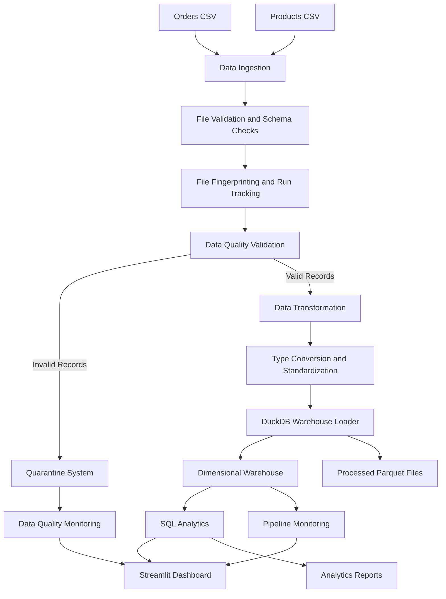

# YottaFlex 72-Hour Challenge — DataFlow

## End-to-End E-Commerce Data Engineering Pipeline

**A reliable, locally executable data engineering platform for CSV ingestion, data quality validation, transformation, warehouse loading, analytics, reconciliation, and pipeline monitoring.**

DataFlow is an end-to-end data engineering solution designed to process imperfect e-commerce data from multiple CSV sources and transform it into a reliable analytical warehouse.

The platform ingests order and product data, validates records, identifies duplicates and inconsistencies, quarantines invalid records with complete source traceability, and loads validated data into a DuckDB dimensional warehouse.

It also provides SQL-based business analytics, data reconciliation, pipeline execution history, performance benchmarking, and an interactive Streamlit dashboard.

**Key highlights**

- End-to-end ETL pipeline.
- Multi-source CSV ingestion.
- Data validation and quality enforcement.
- Rejected-record quarantine with source-line traceability.
- DuckDB dimensional data warehouse.
- Slowly Changing Dimension Type 2 (SCD Type 2).
- Transactional loading and idempotent processing.
- SQL analytics and reconciliation.
- Pipeline monitoring and execution history.
- Interactive Streamlit dashboard.
- Automated test suite with 102 passing tests.

**Designed to run locally without cloud services, API keys, or external credentials.**

---

## 1. Project Overview

### Problem Statement

E-commerce businesses regularly receive data from multiple systems, including order management platforms and product information management systems.

These datasets frequently contain:

- Missing and null values.
- Invalid dates and numerical values.
- Duplicate and conflicting order records.
- References to products that do not exist.
- Unexpected changes in source schemas.
- Late-arriving transactions.
- Product price and status changes.
- Inconsistent customer information.
- Repeated file deliveries and failed processing attempts.

Processing such data without appropriate validation and tracking can result in inaccurate business reports, duplicate transactions, incorrect revenue calculations, and loss of historical information.

### Proposed Solution

DataFlow addresses these challenges through a structured data engineering pipeline.

It provides a repeatable process that:

1. Ingests order and product CSV files.
2. Validates source files and their schemas.
3. Identifies invalid, duplicate, and inconsistent records.
4. Preserves rejected records in a quarantine system.
5. Transforms valid data into standardized analytical formats.
6. Loads data into a DuckDB dimensional warehouse.
7. Maintains historical product information using SCD Type 2.
8. Prevents duplicate processing through file fingerprinting and idempotent loading.
9. Tracks pipeline executions, processing metrics, and failures.
10. Generates business analytics and reconciliation reports.

### Primary Objectives

| Objective | Implementation |
|---|---|
| Reliable ingestion | Multi-source CSV ingestion |
| Data quality | Record-level and batch-level validation |
| Data traceability | Original source records and physical line numbers |
| Historical tracking | SCD Type 2 product dimension |
| Accurate analytics | DuckDB dimensional warehouse |
| Duplicate prevention | SHA-256 file fingerprinting and upserts |
| Failure recovery | Transactional loading and retry support |
| Monitoring | Pipeline execution history and structured logs |
| Business insights | SQL analytics and interactive dashboard |

---

## 2. System Architecture

DataFlow follows a modular ETL architecture consisting of ingestion, validation, transformation, loading, analytics, and monitoring stages.

### Architecture Diagram



### Pipeline Workflow

| Stage | Description |
|---|---|
| 1. Ingestion | Reads order and product CSV files and checks file availability and structure. |
| 2. File tracking | Generates SHA-256 fingerprints and identifies previously processed files. |
| 3. Validation | Checks required fields, data types, duplicates, business rules, and product references. |
| 4. Quarantine | Stores rejected records with rejection reasons and source traceability. |
| 5. Transformation | Standardizes data types, timestamps, dates, and identifiers. |
| 6. Warehouse loading | Loads dimensions and facts into DuckDB within a single transaction. |
| 7. Analytics | Executes SQL queries for business metrics and reconciliation. |
| 8. Monitoring | Tracks pipeline runs, execution times, file statuses, warnings, and failures. |
| 9. Visualization | Presents analytical and operational information through Streamlit. |

For detailed technical documentation, refer to:

- `docs/architecture.md`
- `docs/design_decisions.md`
- `docs/data_dictionary.md`

---

## 3. Technology Stack

The project uses lightweight, locally executable technologies selected for reliability, analytical performance, and ease of deployment.

| Technology | Purpose |
|---|---|
| Python 3.11+ | Core programming language and pipeline orchestration |
| DuckDB | Analytical database and dimensional warehouse |
| SQL | Data modeling, transformations, analytics, and reconciliation |
| Pandas | Record-level data validation and processing |
| PyArrow | Parquet processing and analytical data exchange |
| Parquet | Processed data and quarantine storage |
| Streamlit | Interactive monitoring and analytics dashboard |
| Altair | Dashboard visualizations |
| Faker | Synthetic test data generation |
| NumPy | Deterministic data generation |
| Pytest | Automated testing |
| Python Logging | Structured application and pipeline logging |
| Git and GitHub | Version control and project management |

### Why These Technologies?

**Python**

Python provides a flexible environment for data ingestion, validation, transformation, and orchestration.

**DuckDB**

DuckDB provides an embedded analytical database without requiring a separate database server. It supports efficient SQL queries and analytical workloads.

**Pandas**

Pandas simplifies record-level validation, duplicate detection, and data transformation.

**Parquet**

Parquet provides a columnar storage format suitable for analytical data processing.

**Streamlit**

Streamlit allows operational and business metrics to be presented through an interactive dashboard without requiring a separate frontend application.

**Pytest**

Pytest provides automated verification of data quality rules, warehouse operations, failure recovery, idempotency, and dashboard behavior.

---

## 4. Project Structure

```text
YottaFlex-72hrs-challenge/
│
├── data/
│   ├── sample/
│   │   ├── orders.csv
│   │   ├── products.csv
│   │   ├── orders_batch_2.csv
│   │   └── products_update.csv
│   │
│   ├── labels/
│   │   └── sample/
│   │
│   ├── raw/
│   │   └── <run_id>/
│   │
│   ├── processed/
│   │   └── <run_id>/
│   │
│   ├── quarantine/
│   │   └── <run_id>/
│   │
│   └── warehouse.duckdb
│
├── src/
│   ├── config.py
│   ├── schemas.py
│   ├── datagen.py
│   ├── pipeline.py
│   │
│   ├── ingestion/
│   │   └── reader.py
│   │
│   ├── validation/
│   │   └── rules.py
│   │
│   ├── transformation/
│   │   └── transform.py
│   │
│   ├── warehouse/
│   │   ├── database.py
│   │   └── loader.py
│   │
│   ├── analytics/
│   │   └── queries.py
│   │
│   └── monitoring/
│       ├── logging_setup.py
│       ├── run_history.py
│       ├── lock.py
│       └── trigger.py
│
├── sql/
│   ├── ddl/
│   ├── analytics/
│   ├── reconciliation/
│   └── monitoring/
│
├── scripts/
│   ├── generate_data.py
│   ├── run_analytics.py
│   └── benchmark.py
│
├── dashboard/
│   └── app.py
│
├── tests/
│
├── docs/
│   ├── architecture.md
│   ├── data_dictionary.md
│   ├── design_decisions.md
│   ├── ai_prompt_history.md
│   └── screenshots/
│
├── outputs/
│   ├── analytics/
│   ├── analytics_report.md
│   ├── benchmark_report.md
│   ├── benchmark_results.json
│   └── test_results.txt
│
├── logs/
│   └── pipeline.log
│
├── requirements.txt
├── pyproject.toml
├── .gitignore
└── README.md
```

*Note: Runtime-generated directories and database files are created during execution. The structure above describes the project's logical organization.*

---

## 5. Data Sources and Input Schemas

DataFlow processes two independent CSV sources.

### 5.1 Orders Dataset

Primary key: `order_line_id`

| Column | Description |
|---|---|
| order_line_id | Unique order-line identifier |
| order_id | Order identifier |
| customer_id | Customer identifier |
| product_id | Product reference |
| order_timestamp | Transaction timestamp in ISO-8601 format |
| quantity | Ordered quantity (1–1000) |
| unit_price | Transaction price, greater than zero, up to two decimal places |
| order_status | Order processing status |
| source_file | Optional source file identifier |

Supported order statuses:

- pending
- paid
- shipped
- delivered
- cancelled
- returned

### 5.2 Products Dataset

Primary key: `product_id`, with versions identified by `updated_at`.

| Column | Description |
|---|---|
| product_id | Unique product identifier |
| product_name | Product name |
| category | Product category |
| brand | Brand name (nullable) |
| list_price | Product catalog price |
| product_status | Product availability status |
| updated_at | Product update timestamp |
| source_file | Optional source file identifier |

Supported product statuses:

- active
- discontinued
- out_of_stock

Detailed schemas, validation rules, null handling, and rejection reason codes are documented in `docs/data_dictionary.md`.

---

## 6. Data Warehouse Design

The analytical warehouse follows a dimensional modeling approach using a star schema.

### Fact Table

**`fact_sales`**

Grain: One row per order line.

Important columns:

- `sales_key`
- `order_line_id`
- `order_id`
- `product_key`
- `customer_key`
- `customer_id`
- `date_key`
- `order_timestamp`
- `quantity`
- `unit_price`
- `total_amount`
- `order_status`
- `run_id`
- `row_hash`
- `source_file`
- `source_seq`
- `first_run_id`
- `loaded_at`

The `total_amount` column is calculated as:

```text
total_amount = quantity × unit_price
```

The transaction price is retained independently of the product's current catalog price.

### Dimension Tables

**`dim_product` — SCD Type 2**

Maintains product history through versioned records.

Important attributes:

- `product_key`
- `product_id`
- `product_name`
- `category`
- `brand`
- `list_price`
- `valid_from`
- `valid_to`
- `is_current`

Historical facts reference the product version valid at the time of the transaction.

**`dim_customer` — Type 1**

Maintains customer identifiers and first-order information.

**`dim_date`**

Provides calendar attributes including:

- Date key.
- Full date.
- Day.
- Month.
- Month name.
- Quarter.
- Year.
- Weekday.
- Weekend indicator.

### Operational Tables

The warehouse also maintains:

- `pipeline_runs`
- `run_files`
- `processed_files`
- `quarantine`

Surrogate keys are deterministic, generated using MD5 of business keys, and remain consistent across warehouse rebuilds.

---

## 7. Key Features and Engineering Capabilities

### 7.1 Multi-Source Data Ingestion

- Reads independent orders and products CSV files.
- Validates file availability and required columns.
- Detects unexpected schema changes.
- Handles malformed CSV records.
- Preserves untouched source files for traceability.

### 7.2 Data Quality and Validation

The validation layer checks:

- Missing required fields.
- Null values.
- Invalid data types.
- Negative and zero quantities.
- Invalid prices.
- Invalid timestamps.
- Future timestamps.
- Duplicate order-line identifiers.
- Conflicting duplicate records.
- Unknown product references.
- Invalid order statuses.
- Product catalog inconsistencies.

### 7.3 Rejected-Record Quarantine

Invalid records are not silently discarded.

Each quarantined record preserves:

- Source file.
- Physical source row number.
- Run identifier.
- Primary rejection reason.
- Detailed rejection reasons.
- Original parsed record.
- Exact original source-line text.

Rejected records are also exported to Parquet.

The pipeline enforces the accounting invariant:

```text
Total Input Rows = Valid Rows + Rejected Rows
```

If records cannot be fully accounted for, the validation process fails rather than silently losing data.

### 7.4 Slowly Changing Dimensions

Product catalog changes are tracked using SCD Type 2.

This ensures historical transactions retain the product attributes applicable at the time of sale rather than being associated with the latest catalog version.

### 7.5 Idempotent Data Processing

The pipeline uses:

- SHA-256 file fingerprinting.
- A persistent processed-file ledger.
- Business-key-based fact upserts.
- Duplicate prevention.
- Retryable failed files.
- Forced reprocessing.

Processing an identical file again does not create duplicate fact records.

### 7.6 Transactional Loading

Warehouse loading is performed within a single transaction.

The transaction covers:

1. Dimension updates.
2. Product history updates.
3. Fact upserts.
4. Quarantine persistence.
5. Processing ledger updates.
6. Integrity checks.

If loading fails, the transaction rolls back instead of leaving partially committed warehouse data.

### 7.7 Pipeline Monitoring

The system tracks:

- Run status.
- Start and end timestamps.
- Execution duration.
- Records ingested.
- Valid records.
- Rejected records.
- File processing status.
- Warnings and errors.
- Stage-level execution metrics.

Structured logs are written to `logs/pipeline.log`.

### 7.8 Business Analytics

SQL analytics provide:

- Total recognized revenue.
- Total orders.
- Total quantity sold.
- Daily and monthly revenue.
- Revenue by category.
- Top products.
- Top customers.
- Average order value.
- Rejected-record percentages.

### 7.9 Interactive Dashboard

The Streamlit dashboard provides four pages:

| Dashboard Page | Functionality |
|---|---|
| Pipeline Overview | Run counts, ingestion metrics, rejection metrics, and trends |
| Data Quality | Rejection categories, reasons, and searchable rejected records |
| Business Analytics | Revenue, orders, units, AOV, category analysis, and rankings |
| Pipeline Runs | Execution history, stage timings, file details, warnings, and errors |

The dashboard also includes a Run Pipeline action for the sample batches.

---

## 8. Installation and Setup

### Prerequisites

- Python 3.11 or newer.
- Git.
- VS Code or another code editor.
- Terminal or command prompt.

No cloud account, external database server, API key, or paid service is required.

### Step 1: Clone the Repository

```bash
git clone https://github.com/YOUR-GITHUB-USERNAME/yottaflex-72hrs-challenge.git
```

Replace `YOUR-GITHUB-USERNAME` with your actual GitHub username.

Navigate to the project directory containing `requirements.txt`.

```bash
cd yottaflex-72hrs-challenge
```

If the repository contains the application inside a nested `dataflow/` directory, navigate into that directory before continuing.

### Step 2: Create a Virtual Environment

**macOS / Linux**

```bash
python3 -m venv .venv
```

Activate it:

```bash
source .venv/bin/activate
```

**Windows PowerShell**

```powershell
py -3.12 -m venv .venv
```

Activate it:

```powershell
.venv\Scripts\Activate.ps1
```

**Windows Command Prompt**

```cmd
py -3.12 -m venv .venv
```

Activate it:

```cmd
.venv\Scripts\activate.bat
```

### Step 3: Upgrade pip

```bash
python -m pip install --upgrade pip
```

### Step 4: Install Dependencies

```bash
python -m pip install -r requirements.txt
```

### Step 5: Verify Installation

```bash
python --version
```

Confirm that Python 3.11 or newer is being used.

Run the automated tests:

```bash
python -m pytest -q
```

Expected result from the recorded full test run:

```text
102 passed
```

---

## 9. Generate Sample Data

The project includes sample datasets under `data/sample/`.

To regenerate the sample data:

```bash
python scripts/generate_data.py --sample
```

The generator creates both order and product datasets and a separate labels file describing injected defects.

### Generate Custom Datasets

Generate 1,000 order lines:

```bash
python scripts/generate_data.py --rows 1000
```

Generate 100,000 order lines and 2,000 products:

```bash
python scripts/generate_data.py --orders 100000 --products 2000 --seed 42
```

Generate data with a second batch:

```bash
python scripts/generate_data.py --orders 100000 --products 2000 --with-increment
```

### Supported Arguments

| Argument | Default | Description |
|---|---|---|
| `--sample` | Off | Generates the committed demo dataset |
| `--orders N` | 600 | Number of requested order lines |
| `--rows N` | 600 | Alias for `--orders` |
| `--products N` | 60 | Number of products |
| `--seed N` | 42 | Random seed |
| `--defect-rate F` | 0.03 | Injected order-line defect rate |
| `--out DIR` | Generated directory | Input output location |
| `--labels DIR` | Labels directory | Defect labels location |
| `--with-increment` | Off | Generates incremental product and order files |

The physical CSV row count may exceed the requested order-line count because the generator intentionally injects duplicates and malformed records.

The separate defect-label files are used for verification and are not read by the pipeline.

---

## 10. Execute the Data Pipeline

Run the initial sample batch:

```bash
python -m src.pipeline
```

Run the second batch:

```bash
python -m src.pipeline \
  --orders data/sample/orders_batch_2.csv \
  --products data/sample/products_update.csv
```

Run the same files again:

```bash
python -m src.pipeline
```

The already processed files should be skipped.

Force reprocessing:

```bash
python -m src.pipeline --force
```

### Pipeline Options

| Option | Description |
|---|---|
| `--orders PATH` | Custom orders CSV |
| `--products PATH` | Custom products CSV |
| `--db PATH` | Custom DuckDB database path |
| `--max-reject-ratio 0.5` | Configure the maximum rejected-record ratio |
| `--force` | Reprocess previously loaded files |

### Exit Codes

| Code | Meaning |
|---|---|
| 0 | Successful or skipped execution |
| 1 | Pipeline failure |
| 2 | Another pipeline execution holds the lock |

The pipeline prints a JSON execution summary and records run information in the warehouse.

---

## 11. Launch the Streamlit Dashboard

After running the pipeline, launch the dashboard:

```bash
streamlit run dashboard/app.py
```

Open the following address in your browser:

```text
http://localhost:8501
```

The dashboard provides:

**Pipeline Overview**
- Pipeline execution counts.
- Ingestion and rejection metrics.
- Recent run information.
- Processing trends.

**Data Quality**
- Rejected-record categories.
- Validation failure reasons.
- Searchable rejected-record information.
- Source file and physical line traceability.

**Business Analytics**
- Revenue.
- Orders.
- Units sold.
- Average order value.
- Daily and monthly trends.
- Product and customer rankings.

**Pipeline Runs**
- Run history.
- Processing stages and timings.
- File-level processing information.
- Warnings and errors.
- Run Pipeline action.

All dashboard metrics are queried from the local DuckDB warehouse.

### Dashboard Verification

The dashboard was browser-tested on November 13, 2026, using Google Chrome and Playwright.

Verification covered:

- All four dashboard pages.
- Charts and data tables.
- Sidebar navigation.
- Empty warehouse behavior.
- Desktop viewport (1440 × 900).
- Mobile viewport (390 × 844).
- Pipeline execution through the dashboard.
- Concurrent execution and locking behavior.

The sample batch sequence produced:

```text
Batch 1      SUCCESS
Batch 2      SUCCESS
Batch 1      SKIPPED
```

Concurrent execution attempts were also tested. The pipeline lock prevented a second execution while another run was active.

---

## 12. Testing and Validation

Automated testing is performed using Pytest.

Run the complete test suite:

```bash
python -m pytest
```

Run tests with detailed output:

```bash
python -m pytest -v
```

Run a specific test module:

```bash
python -m pytest tests/test_warehouse.py -k idempot
```

### Test Results

**Latest recorded full test run:**

- Date: November 13, 2026.
- Environment: macOS arm64.
- Python: 3.14.3.
- Result: 102 passed.
- Execution time: 13.73 seconds.

Detailed output is available in:

`outputs/test_results.txt`

### Testing Coverage

| Test Category | Verification |
|---|---|
| Normal ingestion | Valid records load successfully |
| Empty inputs | Empty files and missing files are handled |
| Schema validation | Missing and additional columns are detected |
| Malformed records | Invalid records are quarantined |
| Duplicate detection | Exact and conflicting duplicates are handled |
| Null handling | Required and optional null values are validated |
| Referential integrity | Invalid product references are rejected |
| Business rules | Quantity, price, status, and timestamp rules are enforced |
| Late-arriving data | Historical transactions are processed correctly |
| SCD Type 2 | Product history is maintained |
| Transaction recovery | Failed loads roll back and can be retried |
| Idempotency | Repeated file processing avoids duplicate facts |
| Data reconciliation | Input records are accounted for |
| Raw-record traceability | Original source lines are preserved |
| Concurrency | Simultaneous pipeline execution is prevented |
| Dashboard | All four pages and empty states are tested |

The suite also verifies deterministic keys, decimal precision, customer consistency, status corrections, replay behavior, and generated-dataset reconciliation.

### Data Reconciliation

DataFlow validates the relationship between physical input records, valid records, rejected records, and warehouse facts.

The core invariant is:

```text
Input Rows = Valid Rows + Rejected Rows
```

Additional checks cover:

- Quarantine counts.
- Fact table uniqueness.
- Referential integrity.
- Revenue calculation.
- Order-line accounting.
- Rejection reason breakdown.
- Consistency between source files and warehouse records.

---

## 13. Sample Analytical Results

Revenue is defined as the sum of order-line transaction values for orders with statuses:

- `paid`
- `shipped`
- `delivered`

Cancelled, returned, and pending orders are not included in recognized revenue.

### Sample Warehouse Results

The following results were recorded after loading both sample batches.

| Metric | Result |
|---|---:|
| Recognized Revenue | 307,320.17 |
| Revenue Orders | 201 |
| Orders in All Statuses | 246 |
| Order Lines | 732 |
| Units Sold | 2,475 |
| Average Order Value | 1,528.96 |
| Rejected Records | 27 |
| Source Rows | 831 |
| Rejection Rate | 3.25% |

All recorded reconciliation checks passed after rebuilding the sample warehouse.

### Available Analytical Queries

Run all queries:

```bash
python scripts/run_analytics.py
```

List available queries:

```bash
python scripts/run_analytics.py --list
```

Run a specific query:

```bash
python scripts/run_analytics.py --query 07_top_10_products
```

Results are exported to:

```text
outputs/analytics/
outputs/analytics_report.md
```

### SQL Analytics

| Query | Business Question |
|---|---|
| 01_total_revenue | What is the recognized revenue? |
| 02_total_orders | How many orders and order lines exist? |
| 03_total_quantity | How many units were sold? |
| 04_daily_revenue | What is the daily revenue trend? |
| 05_monthly_revenue | What is the monthly revenue trend? |
| 06_revenue_by_category | Which categories generate the most revenue? |
| 07_top_10_products | Which products perform best? |
| 08_top_10_customers | Which customers generate the most revenue? |
| 09_average_order_value | What is the average order value? |
| 10_rejected_record_pct | What percentage of records are rejected? |

Additional reconciliation queries are available under `sql/reconciliation/`.

---

## 14. Large Dataset Validation

The pipeline was also tested using a generated dataset containing 100,000 requested order lines and 2,000 products.

The generator intentionally adds duplicate and conflicting records.

### Verified Dataset Accounting

| Description | Rows |
|---|---:|
| Requested order lines | 100,000 |
| Injected exact duplicate copies | 200 |
| Injected conflicting copies | 200 |
| Physical order rows | 100,400 |
| Physical product rows | 2,080 |
| Valid order rows | 96,630 |
| Valid product rows | 2,000 |
| Rejected order rows | 3,770 |
| Rejected product rows | 80 |
| Total physical source rows | 102,480 |
| Total valid source rows | 98,630 |
| Total rejected source rows | 3,850 |

The reconciliation equation was satisfied:

```text
102,480 = 98,630 + 3,850
```

Every rejected record was accounted for by its validation category and source traceability.

### Rejection Categories

| Category | Orders | Products |
|---|---:|---:|
| Malformed records | 200 | 0 |
| Duplicates | 600 | 16 |
| Missing values | 400 | 16 |
| Invalid types | 502 | 16 |
| Business rule violations | 1,098 | 32 |
| Invalid references | 970 | 0 |
| **Total** | **3,770** | **80** |

---

## 15. Idempotency and Recovery

DataFlow implements multiple mechanisms to protect the warehouse against duplicate processing and incomplete transactions.

### File Fingerprinting

Each input file receives a SHA-256 fingerprint.

Successfully processed files are recognized even if they are supplied again under a different filename.

### Fact Upserts

Fact records are matched using `order_line_id`.

- New records are inserted.
- Identical records remain unchanged.
- Updated records are updated in place.

### Historical Data Protection

Older files cannot overwrite newer corrections simply because they are replayed later.

### Atomic Transactions

Warehouse changes are committed only after the transaction completes successfully and integrity checks pass.

### Failure Recovery

If an execution is interrupted, its incomplete run is marked failed during subsequent processing. Failed files remain eligible for retry.

### Recorded Idempotency Verification

A fresh warehouse was tested using the same input files three times.

| Table | After Run 1 | After Run 2 | After Forced Run |
|---|---:|---:|---:|
| fact_sales | 967 | 967 | 967 |
| dim_product | 60 | 60 | 60 |
| dim_customer | 114 | 114 | 114 |
| dim_date | 181 | 181 | 181 |
| pipeline_runs | 1 | 2 | 3 |
| processed_files | 2 | 2 | 2 |
| quarantine | 42 | 42 | 84 |

The forced run reported:

```text
Inserted: 0
Updated: 0
Unchanged: 967
```

Quarantine is append-only per run. The dashboard uses the latest processing state when reporting current rejection metrics.

---

## 16. Performance Benchmarking

The project includes a benchmarking utility to measure pipeline performance at different data volumes.

Run:

```bash
python scripts/benchmark.py --sizes 1000 100000 --repeats 5
```

The benchmark:

1. Generates synthetic input data.
2. Creates a fresh warehouse.
3. Executes the pipeline.
4. Measures processing stages.
5. Repeats the experiment.
6. Reports median execution times.
7. Measures forced rerun performance.

### Recorded Benchmark Results

**Environment**

- Apple M1, 8 CPUs.
- macOS 26.6.2.
- Python 3.14.3.
- DuckDB 2.0.0.
- Pandas 3.1.1.
- Five repetitions per dataset size.

| Metric | 1,000 Requested Lines | 100,000 Requested Lines |
|---|---:|---:|
| Physical Input Rows | 1,212 | 102,480 |
| Data Generation | 0.033 s | 0.833 s |
| Ingestion | 0.011 s | 0.458 s |
| Validation | 0.022 s | 0.629 s |
| Transformation | 0.015 s | 0.459 s |
| Loading | 0.044 s | 0.367 s |
| Total Pipeline Time | 0.118 s | 2.056 s |
| Throughput | 10,271 rows/s | 49,844 rows/s |
| Forced Rerun | 0.113 s | 2.303 s |

These are recorded measurements from one laptop, not universal performance guarantees.

The complete methodology, environment details, and limitations are documented in:

- `outputs/benchmark_report.md`
- `outputs/benchmark_results.json`

---

## 17. Engineering Decisions and Trade-offs

The following decisions were made to prioritize data correctness, reproducibility, traceability, and local execution.

| Decision | Reason | Trade-off |
|---|---|---|
| DuckDB instead of a server database | Lightweight local analytical warehouse | Single-node and single-writer architecture |
| Python and SQL | Flexible validation with transparent analytical queries | Some transformations execute in Python |
| Parquet storage | Efficient columnar storage | Additional file management |
| SCD Type 2 for products | Preserves historical catalog changes | More complex dimension loading |
| SHA-256 file fingerprinting | Detects previously processed files | Requires file hashing |
| Transactional warehouse loading | Prevents partial commits | A failed batch must be retried |
| Append-only quarantine | Maintains rejection history | Forced reruns can create additional quarantine rows |
| Whole-order rejection | Prevents inconsistent customer-level reporting | Clean sibling lines can also be rejected |

### Important Business Rule: Inconsistent Customers

An order must belong to exactly one customer.

If the same order is associated with multiple customers, every line belonging to that order in the current batch is quarantined.

This prevents partially loading an inconsistent order and producing incorrect customer rankings, order counts, and average order values.

The decision is documented in `docs/design_decisions.md`.

---

## 18. Known Limitations

The current implementation has the following limitations:

1. **Single-node architecture:** DuckDB operates as a local, single-writer analytical database.
2. **Correction ordering:** Order data does not contain a version or update timestamp, so correction ordering relies on file arrival order.
3. **Returns:** Returned order lines are excluded from recognized revenue; partial refunds are not modeled.
4. **Future timestamps:** Future timestamp validation uses the processing time with a 24-hour tolerance.
5. **Raw storage:** Raw files are copied per run, including forced reruns.
6. **Processing performance:** Validation and key hashing are performed in pandas/Python and become more expensive as data volume grows.
7. **Whole-order rejection:** An order containing multiple customer identifiers is rejected as a whole.
8. **Legacy quarantine records:** Older warehouse records may not contain original source-line text.
9. **Referential integrity:** Integrity is enforced through checks within the load transaction rather than declared foreign-key constraints.
10. **Customer dimension:** The current customer dimension is Type 1 and contains limited descriptive information.

The benchmark was conducted on one Apple M1 machine. Performance may vary depending on hardware, workload, and system utilization.

The Windows setup instructions are provided, but the recorded verification environment is macOS.

---

## 19. Troubleshooting

| Problem | Recommended Solution |
|---|---|
| Python version is unsupported | Install Python 3.11 or newer and recreate the virtual environment |
| Dependency installation fails | Upgrade pip and reinstall using `requirements.txt` |
| `streamlit` command not found | Activate the virtual environment |
| `pytest` command not found | Activate the virtual environment and install dependencies |
| Pipeline exits with code 2 | Another execution holds the pipeline lock; wait for it to finish |
| Pipeline status is SKIPPED | The file was already processed; use `--force` if reprocessing is required |
| Pipeline fails due to schema validation | Correct the source file and retry |
| Dashboard shows an empty warehouse | Execute the pipeline before opening the dashboard |
| Dashboard says pipeline is writing | Wait for the active warehouse transaction to finish and refresh |
| Dashboard displays another database | Check `DATAFLOW_DB_PATH` |
| Streamlit reports an unsupported width option | Reinstall dependencies using `requirements.txt` |

### Environment Variables

The following environment variables can be used to configure storage locations:

```text
DATAFLOW_DB_PATH
DATAFLOW_ORDERS_PATH
DATAFLOW_PRODUCTS_PATH
DATAFLOW_RAW_DIR
DATAFLOW_PROCESSED_DIR
DATAFLOW_QUARANTINE_DIR
DATAFLOW_LOGS_DIR
```

For isolated testing, point the database and storage directories to temporary locations rather than modifying existing project data.

---

## 20. AI Assistance and Prompt History

AI tools were used as development assistance during the project.

Their role, the prompts used, and the developer's own validation work must be documented transparently.

### AI Usage Disclosure

AI assistance may be used to accelerate:

- Technical research and implementation planning.
- Code review and debugging.
- Test-case identification.
- SQL and data engineering problem-solving.
- Documentation improvements.
- Architecture discussions and edge-case analysis.

### Personal Review and Validation

The developer's responsibility includes understanding and reviewing the implementation.

The project was validated through:

- Reviewing the pipeline architecture and execution flow.
- Running the automated test suite.
- Verifying the 102 recorded passing tests.
- Checking ingestion and rejection accounting.
- Verifying warehouse loading and idempotency.
- Testing failure recovery and concurrency controls.
- Executing analytical and reconciliation queries.
- Browser-testing the four dashboard pages.
- Running performance benchmarks.

AI-generated suggestions should not be treated as verified results without independent testing.

### Prompt History

The complete prompts submitted to the AI tools used during development must be included in:

`docs/ai_prompt_history.md`

The prompt history should include all prompts submitted to each AI tool, with the tool name and relevant date or sequence where available. AI responses are optional under the submission guidelines.

If a tool does not provide an exportable history, maintain a reasonable manual record and disclose that limitation.

**Important:** Ensure the prompt-history document contains the actual prompts used during development. Do not substitute reconstructed or invented prompts for the original history.

---

## 21. Security and Data Privacy

- No API keys or external service credentials are required.
- No cloud services are required.
- The application uses local files and a local DuckDB database.
- Sensitive configuration files should not be committed.
- `.gitignore` excludes `.env` and Streamlit secrets.
- Synthetic sample data is used for demonstration and testing.

Never commit passwords, access tokens, private credentials, or sensitive personal information to the public repository.

---

## 22. Future Improvements

Potential improvements include:

- Moving computationally expensive validation and key hashing operations into DuckDB.
- Supporting partitioned Parquet storage for larger datasets.
- Adding Airflow or Dagster orchestration.
- Introducing automated alerts for pipeline failures and unusual rejection rates.
- Implementing versioned YAML-based data contracts.
- Adding a quarantine review and record-release interface.
- Introducing a customer master source and SCD Type 2 customer dimension.
- Expanding monitoring and operational reporting.

These are proposed enhancements and are not claimed as completed functionality.

---

## 23. Supporting Documentation and Evidence

The repository includes supporting material to help reviewers understand the implementation and verify its behavior.

| Artifact | Purpose |
|---|---|
| `docs/architecture.md` | Detailed architecture and execution lifecycle |
| `docs/data_dictionary.md` | Source, warehouse, and operational schemas |
| `docs/design_decisions.md` | Technical decisions and trade-offs |
| `docs/ai_prompt_history.md` | Complete AI prompt history |
| `docs/screenshots/` | Dashboard screenshots |
| `outputs/test_results.txt` | Recorded automated test results |
| `outputs/benchmark_report.md` | Benchmark methodology and results |
| `outputs/benchmark_results.json` | Raw benchmark results |
| `outputs/analytics_report.md` | Business analytics results |
| `tests/` | Automated test suite |
| `sql/` | Warehouse, analytics, reconciliation, and monitoring queries |

---

## 24. Challenge Submission Information

**Challenge:** YottaFlex AI — 72-Hour Candidate Project Challenge

**Project:** DataFlow — End-to-End E-Commerce Data Engineering Pipeline

**Repository:** YottaFlex-72hrs-challenge

**Implementation:** Python, SQL, DuckDB, Parquet, Streamlit

**Execution:** Local and reproducible

**Testing:** 102 recorded passing automated tests

**Dashboard:** Four-page interactive Streamlit application

**AI Disclosure:** Prompt history and developer review documentation

### Submission Readiness Checklist

Before submitting, verify the following:

- [ ] GitHub repository is public.
- [ ] Complete source code is committed.
- [ ] README contains accurate setup and execution instructions.
- [ ] Dependencies are listed in `requirements.txt`.
- [ ] Sample datasets are available.
- [ ] Automated tests can be executed.
- [ ] Test evidence is included.
- [ ] Architecture documentation is included.
- [ ] Data dictionary is included.
- [ ] Engineering decisions and trade-offs are documented.
- [ ] Complete AI prompt history is included.
- [ ] AI usage and personal validation are disclosed.
- [ ] Dashboard screenshots and supporting evidence are included.
- [ ] No credentials, API keys, or sensitive information are committed.
- [ ] Git history contains meaningful development commits.

---

## 25. Conclusion

DataFlow demonstrates an end-to-end approach to building a reliable data engineering pipeline using locally executable technologies.

The implementation focuses on more than simply loading CSV files into a database. It addresses the engineering challenges involved in handling imperfect data, preserving historical information, preventing duplicate processing, recovering from failures, maintaining record-level traceability, and producing trustworthy analytical results.

Through dimensional modeling, transactional loading, SQL analytics, automated testing, performance benchmarking, and operational monitoring, the project demonstrates a structured approach to building reproducible data systems.

**The objective is simple: transform unreliable source data into accurate, traceable, and actionable business information.**

---

**YottaFlex 72-Hour Challenge | DataFlow | 2026**