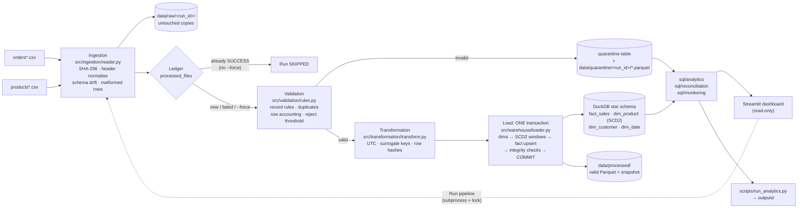
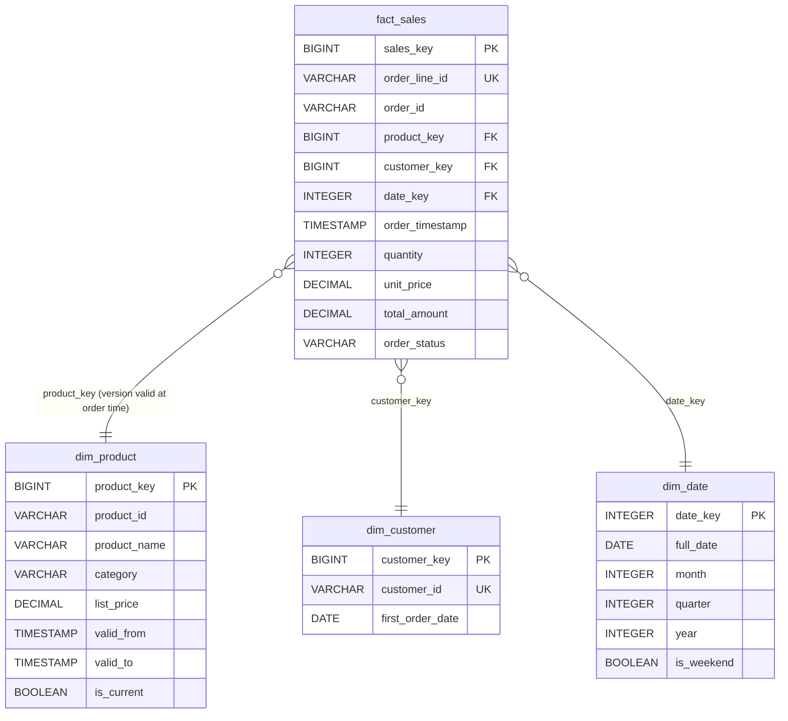

# DataFlow: End-to-End E-Commerce Data Pipeline

**YottaFlex AI: 72-Hour Candidate Project Challenge (Data Engineering)**

DataFlow takes two messy CSV sources (orders and a product catalogue), checks every record, quarantines
bad records with full lineage to the source line, and loads the clean data into a **DuckDB star schema**.
Loading is transactional and idempotent. The project also includes SQL analytics, reconciliation checks,
run history, a Streamlit dashboard and 102 automated tests.

Everything runs locally: there is no cloud account, database server, API key or credential.

| | |
|---|---|
| **Stack** | Python 3.11+ · DuckDB · pandas · PyArrow/Parquet · Streamlit/Altair · pytest |
| **Tests** | 102 passed (latest full run 2026-11-14, see [Testing](#20-testing-approach-and-results)) |
| **Sample result** | 831 source rows → 804 valid + 27 quarantined; reconciliation ALL PASS |
| **Scale check** | 102,480 source rows processed in 2.06 s (median of 5, Apple M1) |

---

## Contents

1. [Project overview](#1-project-overview)
2. [Business problem and objectives](#2-business-problem-and-objectives)
3. [Key features](#3-key-features)
4. [Technology stack](#4-technology-stack)
5. [System architecture](#5-system-architecture)
6. [Repository structure](#6-repository-structure)
7. [Source schemas and dimensional model](#7-source-schemas-and-dimensional-model)
8. [Data ingestion workflow](#8-data-ingestion-workflow)
9. [Data validation and business rules](#9-data-validation-and-business-rules)
10. [Duplicate handling and quarantine](#10-duplicate-handling-and-rejected-record-quarantine)
11. [Transformation and warehouse loading](#11-transformation-and-warehouse-loading)
12. [Analytical SQL and dashboard](#12-analytical-sql-queries-and-dashboard)
13. [Monitoring, logging and run history](#13-monitoring-logging-and-run-history)
14. [Idempotency, retry and recovery](#14-idempotency-retry-and-recovery)
15. [Installation and setup](#15-installation-and-setup)
16. [Running the pipeline, tests and dashboard](#16-running-the-pipeline-tests-and-dashboard)
17. [Sample outputs and expected results](#17-sample-outputs-and-expected-results)
18. [Reconciliation and data-quality checks](#18-reconciliation-and-data-quality-checks)
19. [Performance benchmark](#19-performance-benchmark-and-optimisation)
20. [Testing approach and results](#20-testing-approach-and-results)
21. [Design decisions and trade-offs](#21-design-decisions-and-trade-offs)
22. [Assumptions and limitations](#22-assumptions-and-limitations)
23. [Future improvements](#23-future-improvements)
24. [AI usage disclosure](#24-ai-usage-disclosure)
25. [Supporting documentation](#25-supporting-documentation)

---

## 1. Project overview

DataFlow is a batch ETL pipeline. One run (`python -m src.pipeline`) does the following:

1. Reads an orders CSV and a products CSV, fingerprints them (SHA-256), and keeps an untouched copy of each.
2. Skips any file whose exact content has already been loaded successfully.
3. Checks every record against the source contract and business rules.
4. Writes rejected records to a `quarantine` table and to Parquet, with the reason, the source file, the
   line number and the exact original CSV text.
5. Transforms the valid records and loads `dim_date`, `dim_customer`, `dim_product` (SCD Type 2) and
   `fact_sales` in **one DuckDB transaction**, with integrity checks before `COMMIT`.
6. Records the run (status, row counts, stage timings, warnings, errors) in `pipeline_runs`.

The SQL files in `sql/` then produce business metrics and reconciliation results. The Streamlit
dashboard displays the same queries.

## 2. Business problem and objectives

E-commerce source extracts are unreliable. Values are missing or malformed, rows are duplicated or
contradict each other, orders reference products that do not exist, columns change, the same file is
delivered twice, records arrive late, and catalogue prices change. If such data is loaded naively,
revenue is wrong, orders are counted twice and history is lost.

| Objective | How DataFlow meets it |
|---|---|
| Trustworthy revenue | Transaction price × quantity in exact `DECIMAL`; only `paid/shipped/delivered` counts as revenue |
| No silent data loss | `input = valid + rejected` is enforced in code and checked again in SQL |
| Traceable rejections | Every rejected row keeps file, line number, run, reasons and exact source text |
| History-correct reporting | `dim_product` is SCD Type 2; each fact links to the product version valid at order time |
| Safe re-runs | Content-hash ledger, upsert by business key, and an arrival-order guard |
| No partial loads | One transaction per batch; integrity checks before commit; rollback on any error |
| Operational visibility | `pipeline_runs`, `run_files`, JSON logs and a four-page dashboard |

## 3. Key features

- Two-source CSV ingestion with header normalisation (`Order Line ID` → `order_line_id`),
  schema-drift detection and capture of malformed rows.
- 17 record-level rejection reason codes plus three batch-level failure codes.
- A quarantine table and Parquet files with `source_line`, the exact original CSV text of the record.
- A star schema: `fact_sales` (one row per order line), `dim_product` (SCD2), `dim_customer`, `dim_date`.
- Deterministic MD5-based surrogate keys, so independent rebuilds produce the same keys.
- Idempotent loading: SHA-256 file ledger, `order_line_id` upsert, and a `source_seq` guard so that
  replaying an old file cannot undo a newer correction.
- One transaction per batch, integrity checks before commit, automatic recovery of interrupted runs.
- A single-writer lock file that blocks simultaneous runs (CLI, dashboard button or threads).
- 10 analytics queries, 4 reconciliation queries and 11 monitoring queries, all plain `.sql` files.
- A Streamlit dashboard: Pipeline Overview, Data Quality, Business Analytics and Pipeline Runs.
- A seeded synthetic data generator that writes injected-defect labels to a **separate** file.
- A benchmark script and 102 pytest cases, each running in an isolated temporary warehouse.

## 4. Technology stack

| Technology | Version tested | Used for |
|---|---|---|
| Python | 3.14.3 (`requires-python >= 3.11`) | Orchestration, ingestion, validation |
| DuckDB | 2.0.0 | Embedded analytical warehouse, SQL, transactions |
| pandas / NumPy | 3.1.1 / 2.5.4 | Vectorised validation and staging |
| PyArrow | 26.0.1 | Parquet export, zero-copy DataFrame → DuckDB loads |
| Faker | 40.54.0 | Synthetic data generation |
| Streamlit / Altair | 1.67.0 / 6.3.0 | Dashboard |
| pytest | 9.2.0 | Automated tests |

Minimum versions are pinned in [`requirements.txt`](requirements.txt). DuckDB was chosen because it gives
a real SQL warehouse (transactions, `ASOF JOIN`, window functions, Parquet) with nothing to install or
host. That suits a reproducible, laptop-scale challenge.

## 5. System architecture



Each stage writes its row counts and timings to `pipeline_runs`. The lifecycle of a run, the
concurrency model and the module map are in [`docs/architecture.md`](docs/architecture.md).

## 6. Repository structure

```text
YottaFlex-72hrs-challenge/
├── src/
│   ├── pipeline.py              # orchestrator + CLI (python -m src.pipeline)
│   ├── config.py                # paths/thresholds, DATAFLOW_* env overrides
│   ├── schemas.py               # source contracts, allowed statuses, bounds
│   ├── datagen.py               # seeded synthetic data with injected defects
│   ├── ingestion/reader.py      # file checks, normalisation, drift, malformed rows, raw copy
│   ├── validation/rules.py      # record rules, reason codes, duplicate logic, row accounting
│   ├── transformation/transform.py  # surrogate keys, staging frames
│   ├── warehouse/database.py    # connections (retry on lock), DDL bootstrap
│   ├── warehouse/loader.py      # transactional idempotent load, SCD2, integrity checks
│   ├── analytics/queries.py     # runs the SQL files in sql/
│   └── monitoring/              # JSON logging, run history, lock file, dashboard trigger
├── sql/
│   ├── ddl/warehouse.sql        # all tables and views
│   ├── analytics/               # 01–10 business queries
│   ├── reconciliation/          # 01–04 accounting checks
│   └── monitoring/              # run, file and quarantine queries used by the dashboard
├── scripts/
│   ├── generate_data.py         # CLI for the generator
│   ├── run_analytics.py         # runs all queries → outputs/analytics/*.csv + report
│   └── benchmark.py             # timing benchmark → outputs/benchmark_*
├── dashboard/app.py             # Streamlit app (4 pages)
├── tests/                       # 102 pytest cases (isolated temp warehouses)
├── data/
│   ├── sample/                  # committed input: 2 order files, 2 product files
│   ├── labels/sample/           # injected-defect labels (never read by the pipeline)
│   └── raw/ processed/ quarantine/   # created at run time (git-ignored)
├── outputs/                     # committed evidence: analytics, reconciliation, benchmark, tests
├── docs/                        # architecture, data dictionary, decisions, testing, performance, screenshots
├── prompt_history/              # AI prompts used during development
├── logs/                        # pipeline.log (JSON lines), created at run time
├── requirements.txt · pyproject.toml · .streamlit/config.toml · .gitignore
```

`data/warehouse.duckdb`, `data/raw/*`, `data/processed/*`, `data/quarantine/*` and `logs/*` are generated
by a run and are git-ignored.

## 7. Source schemas and dimensional model

### Source contracts (`src/schemas.py`)

**Orders**: one row per order line, primary key `order_line_id`

| Column | Required | Rule summary |
|---|---|---|
| `order_line_id` | yes | Unique within the batch |
| `order_id` | yes | All lines of an order must have the same customer |
| `customer_id` | yes | |
| `product_id` | yes | Must exist in this batch's valid products or in `dim_product` |
| `order_timestamp` | yes | ISO-8601, converted to UTC; between 2000-01-01 and run time + 24 h |
| `quantity` | yes | Integer, 1–1000 |
| `unit_price` | yes | > 0, ≤ 1,000,000, at most 2 decimals |
| `order_status` | yes | `pending, paid, shipped, delivered, cancelled, returned` (case-insensitive) |
| `source_file` | no | Always overwritten with the real file name (lineage) |

**Products**: primary key `product_id`, versioned by `updated_at`

| Column | Required | Rule summary |
|---|---|---|
| `product_id`, `product_name`, `category` | yes | |
| `brand` | **no** | Nullable |
| `list_price` | yes | Same numeric rules as `unit_price`; catalogue price only, never used for revenue |
| `product_status` | yes | `active, discontinued, out_of_stock` |
| `updated_at` | yes | Becomes the SCD2 `valid_from` |
| `source_file` | no | As for orders |

### Target star schema (`sql/ddl/warehouse.sql`)



| Table | Type | Grain / notes |
|---|---|---|
| `fact_sales` | Fact | One row per order line. `total_amount = quantity × unit_price` as `DECIMAL(18,2)`. Lineage columns: `row_hash`, `source_file`, `source_seq`, `run_id`, `first_run_id`, `loaded_at` |
| `dim_product` | SCD Type 2 | One row per (`product_id`, `updated_at`). `valid_from`/`valid_to`/`is_current` |
| `dim_customer` | Type 1 | `customer_id`, `first_order_date` (moved earlier if a late order arrives) |
| `dim_date` | Calendar | `YYYYMMDD` key; a continuous range covering every order date |
| `pipeline_runs`, `run_files`, `processed_files`, `quarantine` | Operational | Run history, per-file counts, idempotency ledger, rejected rows |
| `v_sales`, `v_current_file_runs`, `v_quarantine_current`, `v_quarantine_reasons` | Views | Analytics join; latest processing of each file (avoids double counting) |

Every column is documented in [`docs/data_dictionary.md`](docs/data_dictionary.md).

## 8. Data ingestion workflow

`src/ingestion/reader.py`:

1. **File check.** A missing path raises `SOURCE_UNAVAILABLE`, which fails the batch.
2. **Fingerprint.** The SHA-256 of the file content becomes the idempotency key.
3. **Header.** BOM stripped, names converted to snake_case. Duplicate names after normalisation, or a
   missing mandatory column, raise `SCHEMA_MISMATCH` (batch failure). An extra column produces a
   `SCHEMA_DRIFT` warning: it is ignored for loading but kept in the raw copy.
4. **Rows.** Parsed with Python's `csv` module, **every value kept as text**, so a bad value becomes
   a traceable rejection and never crashes the run. Rows with the wrong number of fields become
   `MALFORMED_RECORD`. Blank lines are counted in a `BLANK_LINES` warning. Null tokens (`""`, `NULL`,
   `None`, `NaN`, `N/A`, …) are converted to null.
5. **Exact text.** A line recorder keeps the original text of each record, which becomes
   `quarantine.source_line` if the record is rejected.
6. **Raw copy.** The untouched file is copied to `data/raw/<run_id>/`.
7. **Ledger.** If the file's hash is already `SUCCESS` in `processed_files` and `--force` was not given,
   the file is skipped. If both files are skipped, the run status is `SKIPPED`.

An empty file (zero bytes or header only) gives an `EMPTY_FILE` warning, not an error.

## 9. Data validation and business rules

`src/validation/rules.py` builds one vectorised boolean mask per rule. A record can fail several rules,
and all of its reasons are stored.

| Reason code | Rule |
|---|---|
| `MISSING_REQUIRED_FIELD` | A required column is null |
| `INVALID_DATA_TYPE` | `quantity` is not an integer, or a price is not numeric |
| `INVALID_TIMESTAMP` | Not a parseable ISO-8601 value (ambiguous formats such as `31/12/2026` are rejected) |
| `TIMESTAMP_OUT_OF_RANGE` | Before 2000-01-01 or more than 24 h after the run time |
| `NEGATIVE_QUANTITY` / `ZERO_QUANTITY` / `QUANTITY_OUT_OF_RANGE` | Quantity < 0 / = 0 / > 1000 |
| `INVALID_PRICE` / `INVALID_PRICE_PRECISION` | ≤ 0 or > 1,000,000 / more than 2 decimals |
| `INVALID_STATUS` | Status not in the allowed set (after trimming and lower-casing) |
| `INVALID_PRODUCT_REFERENCE` | `product_id` not in this batch's valid products or in `dim_product` |
| `INCONSISTENT_ORDER_CUSTOMER` | An `order_id` linked to more than one `customer_id` (in the batch or against the warehouse): **every line of that order in the batch is rejected** |
| `DUPLICATE_RECORD`, `CONFLICTING_DUPLICATE_KEY`, `SUPERSEDED_DUPLICATE`, `CONFLICTING_PRODUCT_VERSION` | See §10 |
| `MALFORMED_RECORD` | Wrong number of fields (from ingestion) |

**Batch-level failures** (nothing is loaded and the run is recorded as `FAILED`): `SOURCE_UNAVAILABLE`,
`SCHEMA_MISMATCH`, and `REJECT_THRESHOLD_EXCEEDED`. The last one applies when more than
`max_reject_ratio` (default 50 %) of a file's rows are rejected, which usually means a broken export.
The rejected rows of that batch are still written to quarantine for diagnosis.

**Row accounting.** `check_accounting()` raises `ValidationInvariantError` (the batch fails and is rolled
back) if `valid + rejected ≠ input`, or if two valid rows still share a grain key. Validation never
deletes a row itself.

The reasons for the whole-order rejection rule and its measured impact are in
[`docs/design_decisions.md` D14](docs/design_decisions.md).

## 10. Duplicate handling and rejected-record quarantine

| Situation | Outcome |
|---|---|
| Same `order_line_id`, identical content | First physical row loaded; the other copies → `DUPLICATE_RECORD` |
| Same `order_line_id`, different content, same file | **All** copies → `CONFLICTING_DUPLICATE_KEY` (there is no basis for choosing one) |
| Same `product_id` several times in a file | Latest `updated_at` kept; older rows → `SUPERSEDED_DUPLICATE`; ties with different content → `CONFLICTING_DUPLICATE_KEY` |
| Product version (`product_id` + `updated_at`) already loaded with different attributes | `CONFLICTING_PRODUCT_VERSION` (history is never silently rewritten) |
| Same `order_line_id` arriving in a **later file** | Not a duplicate: it is an upsert (see §14) |

**Quarantine record.** Each rejected row is written inside the load transaction to the `quarantine` table
and to `data/quarantine/<run_id>/<source>_rejected.parquet`. It contains:

`run_id · source_type · source_file · file_hash · source_row_number (physical line, header = 1) ·
record_id · primary_reason · rejection_reasons ("CODE: detail; …") · raw_record (JSON) ·
source_line (exact original CSV text) · rejected_at`

The quarantine table is append-only per run. The views `v_quarantine_current` and `v_current_file_runs`
count only the latest successful processing of each file, so forced reruns are not counted twice.

## 11. Transformation and warehouse loading

**Transformation** (`src/transformation/transform.py`):

- Timestamps → UTC; `date_key = YYYYMMDD` of the UTC date.
- Surrogate keys = first 60 bits of `md5(prefix | business key)`, so they are the same in every rebuild.
- `row_hash` of the business attributes, used to detect changed re-deliveries.
- `dim_date` is generated as a continuous calendar covering the batch's order dates.

**Loading** (`src/warehouse/loader.py`) runs inside **one** `BEGIN … COMMIT`:

1. `dim_date`: insert dates that are not yet present.
2. `dim_customer`: insert new customers; move `first_order_date` earlier if a late order arrives.
3. `dim_product`: insert new versions, then recalculate the SCD2 windows with `LEAD()` (this also
   handles back-dated updates) and re-point affected facts to the correct version.
4. `fact_sales`: link each order to its product version with an `ASOF JOIN` on `order_timestamp`, then
   upsert on `order_line_id` (insert new, update changed, leave identical rows alone, skip stale rows).
5. Integrity checks: no orphan product, customer or date keys; one current version per product; no
   overlapping windows; unique order lines; `total_amount = quantity × unit_price`.
6. Quarantine rows and ledger entries, then `COMMIT`. Any exception → `ROLLBACK`.

All writes are set-based: a pandas frame is registered with DuckDB and loaded with one
`INSERT … SELECT` or `UPDATE … FROM`.

## 12. Analytical SQL queries and dashboard

Revenue = the sum of `quantity × unit_price` for lines with status `paid`, `shipped` or `delivered`.
`pending`, `cancelled` and `returned` lines stay in the fact table but are reported separately.

| File (`sql/analytics/`) | Question |
|---|---|
| `01_total_revenue.sql` | Recognised revenue, plus pending and cancelled/returned value |
| `02_total_orders.sql` | Revenue orders, all orders, order lines |
| `03_total_quantity.sql` | Units sold |
| `04_daily_revenue.sql` | Revenue, orders and units per day |
| `05_monthly_revenue.sql` | Revenue and orders per month |
| `06_revenue_by_category.sql` | Revenue by category (category at time of sale) and share % |
| `07_top_10_products.sql` | Top 10 products by revenue |
| `08_top_10_customers.sql` | Top 10 customers by purchase value |
| `09_average_order_value.sql` | AOV = revenue ÷ distinct revenue orders |
| `10_rejected_record_pct.sql` | Rejected % by source and overall |

The reconciliation queries are in `sql/reconciliation/` (§18). The run, file and quarantine queries
are in `sql/monitoring/`.

**Dashboard** (`dashboard/app.py`). It opens the warehouse read-only for each page and runs the same
SQL files, so no values are hard-coded.

| Page | Shows |
|---|---|
| Pipeline Overview | Total/successful/failed/skipped runs; records ingested, valid and rejected; last execution; charts of valid vs rejected rows per run and run duration |
| Data Quality | Failures by category and reason; searchable rejected rows with file, line and source text; scope switch (current / all runs) |
| Business Analytics | Revenue, orders, units, AOV, daily/monthly trend, category split, top products and customers |
| Pipeline Runs | Run history, stage timings, per-file actions, warnings and errors; **Run pipeline** button for sample batch 1 or 2, with an optional "Force reprocess" (disabled while a run holds the lock) |

Screenshots: [`docs/screenshots/`](docs/screenshots/)
([overview](docs/screenshots/1_overview.png) ·
[data quality](docs/screenshots/2_data_quality.png) ·
[business](docs/screenshots/3_business.png) ·
[runs](docs/screenshots/4_runs.png)).

## 13. Monitoring, logging and run history

| Mechanism | Where | Contents |
|---|---|---|
| Run history | `pipeline_runs` table | `run_id`, start/end, duration, status `RUNNING/SUCCESS/FAILED/SKIPPED`, trigger (`cli/dashboard/test/benchmark`), `forced`, input/valid/rejected/output rows per source, facts inserted/updated/unchanged/stale-skipped, timing for each of the four stages, warnings (JSON), error (`[batch|system:CODE] message`) |
| Per-file record | `run_files` table | File name, SHA-256, action (`PROCESSED/SKIPPED_ALREADY_PROCESSED/FAILED`), row counts |
| Idempotency ledger | `processed_files` table | Hash, status, attempts, last error, arrival sequence |
| Structured log | `logs/pipeline.log` | One JSON object per line: `ts`, `level`, `run_id`, `stage`, message, extra fields |
| Console log | stderr | `HH:MM:SS LEVEL [run_id] [stage] message` |
| Run summary | stdout | JSON summary of each run (status, metrics, warnings, error) |

## 14. Idempotency, retry and recovery

| Layer | Mechanism | Effect |
|---|---|---|
| File | SHA-256 ledger in `processed_files` | An identical file is skipped, even if renamed. A failed file is **not** marked done, so it is retried on the next run |
| Row | Upsert on `order_line_id` + `row_hash` | Identical rows are untouched; changed rows are updated in place; new rows are inserted |
| Ordering | `source_seq` (arrival order of the file) | Replaying an older file cannot overwrite a newer correction (counted as `facts_stale_skipped`) |
| Transaction | One `BEGIN … COMMIT` per batch + integrity checks | A failure leaves the warehouse exactly as before |
| Crash | `mark_stale_runs()` at the start of the next run | A run left `RUNNING` by a killed process is marked `FAILED` |
| Concurrency | `logs/pipeline.lock` created with `O_EXCL` (pid + run_id) | A second run exits with code 2; locks left by dead processes are cleared |

`--force` reprocesses files that were already loaded. Because the upsert is idempotent, a forced rerun of
unchanged files gives 0 inserts and 0 updates (verified, §18).

## 15. Installation and setup

**Prerequisites:** Python **3.11 or newer** and Git. Nothing else is needed: no database server, cloud
account or API key.

### macOS / Linux

```bash
git clone https://github.com/vaishh-samala/YottaFlex-72hrs-challenge.git
cd YottaFlex-72hrs-challenge
python3 -m venv .venv
source .venv/bin/activate
python -m pip install --upgrade pip
python -m pip install -r requirements.txt
python --version            # must be 3.11+
```

### Windows (PowerShell)

```powershell
git clone https://github.com/vaishh-samala/YottaFlex-72hrs-challenge.git
cd YottaFlex-72hrs-challenge
py -3 -m venv .venv
.\.venv\Scripts\Activate.ps1
# If activation is blocked: Set-ExecutionPolicy -Scope Process -ExecutionPolicy Bypass
python -m pip install --upgrade pip
python -m pip install -r requirements.txt
python --version            # must be 3.11+
```

> The project was developed and verified on macOS. The Windows commands are standard equivalents and
> have **not** been run on a Windows machine (see §22).

## 16. Running the pipeline, tests and dashboard

Run every command from the repository root with the virtual environment active. Unless stated
otherwise, each command is the same on macOS/Linux and on Windows PowerShell.

### Pipeline

```bash
# 1. First sample batch (data/sample/orders.csv + products.csv)
python -m src.pipeline

# 2. Second batch: new orders, status corrections, product updates
python -m src.pipeline --orders data/sample/orders_batch_2.csv --products data/sample/products_update.csv

# 3. Same files again → status SKIPPED (idempotency)
python -m src.pipeline

# 4. Force reprocessing → 0 inserts, 0 updates
python -m src.pipeline --force
```

| Option | Meaning |
|---|---|
| `--orders PATH` / `--products PATH` | Input files (default: the sample batch 1 files) |
| `--db PATH` | Warehouse file (default `data/warehouse.duckdb`) |
| `--force` | Reprocess files that were already loaded |
| `--max-reject-ratio F` | Batch rejection threshold, 0–1 (default 0.5) |

Exit codes: **0** = SUCCESS or SKIPPED, **1** = FAILED, **2** = another run holds the lock.

### Analytics and reconciliation

```bash
python scripts/run_analytics.py                         # all queries → outputs/analytics/*.csv + outputs/analytics_report.md
python scripts/run_analytics.py --list                  # list query names
python scripts/run_analytics.py --query 01_total_revenue
```

Exit code 1 if any reconciliation check fails. Note: the first command **overwrites** the committed
files in `outputs/`.

### Tests

```bash
python -m pytest            # full suite
python -m pytest -v         # one line per test
```

### Dashboard

```bash
streamlit run dashboard/app.py          # then open http://localhost:8501
```

Run the pipeline first. With no warehouse, the dashboard shows an empty state.

### Synthetic data and benchmark

```bash
python scripts/generate_data.py --sample                      # regenerate data/sample (+ labels)
python scripts/generate_data.py --rows 1000                   # → data/generated/1000/
python scripts/generate_data.py --orders 100000 --products 2000 --seed 42
python scripts/benchmark.py --sizes 1000 100000 --repeats 5   # overwrites outputs/benchmark_*; use --out DIR to keep them
```

Generator options: `--sample`, `--orders/--rows N` (default 600), `--products N` (60), `--seed N` (42),
`--defect-rate F` (0.03), `--out DIR`, `--labels DIR`, `--with-increment`.

On macOS/Linux, multi-line commands use `\` to continue a line. On Windows PowerShell, use a backtick
`` ` `` or put the command on one line.

### Configuration and isolated runs

Every path can be overridden with an environment variable: `DATAFLOW_DB_PATH`, `DATAFLOW_RAW_DIR`,
`DATAFLOW_PROCESSED_DIR`, `DATAFLOW_QUARANTINE_DIR`, `DATAFLOW_LOGS_DIR`, `DATAFLOW_ORDERS_PATH`,
`DATAFLOW_PRODUCTS_PATH`. Further settings: `DATAFLOW_MAX_REJECT_RATIO`, `DATAFLOW_DB_CONNECT_TIMEOUT`, and
`DATAFLOW_WRITE_PARQUET=0` to turn off the Parquet exports.

```bash
export DATAFLOW_DB_PATH=/tmp/df/wh.duckdb DATAFLOW_RAW_DIR=/tmp/df/raw DATAFLOW_PROCESSED_DIR=/tmp/df/processed \
       DATAFLOW_QUARANTINE_DIR=/tmp/df/quarantine DATAFLOW_LOGS_DIR=/tmp/df/logs
python -m src.pipeline
```

```powershell
$env:DATAFLOW_DB_PATH = "$env:TEMP\df\wh.duckdb"; $env:DATAFLOW_LOGS_DIR = "$env:TEMP\df\logs"
$env:DATAFLOW_RAW_DIR = "$env:TEMP\df\raw"; $env:DATAFLOW_PROCESSED_DIR = "$env:TEMP\df\processed"
$env:DATAFLOW_QUARANTINE_DIR = "$env:TEMP\df\quarantine"
python -m src.pipeline
```

### Troubleshooting

| Symptom | Fix |
|---|---|
| `ModuleNotFoundError: src` | Run from the repository root with `python -m src.pipeline`, not `python src/pipeline.py` |
| `streamlit`/`pytest` not found | Activate the virtual environment |
| Exit code 2 / `LOCKED` | Another run is in progress; wait for it to finish (locks left by dead processes clear themselves) |
| Status `SKIPPED` | The files were already loaded; use `--force` to reprocess them |
| Dashboard says the pipeline is writing | Refresh after the run commits |
| Dashboard shows other data | Check `DATAFLOW_DB_PATH` |

## 17. Sample outputs and expected results

On a fresh warehouse, steps 1–3 of §16 give the following. These numbers were re-run and matched on
2026-11-14.

| Run | Status | Input rows | Valid | Rejected | Facts inserted / updated |
|---|---|---:|---:|---:|---|
| Batch 1 | SUCCESS | 667 | 642 | 25 | 582 / 0 |
| Batch 2 | SUCCESS | 164 | 162 | 2 | 150 / 5 (status corrections) |
| Batch 1 again | SKIPPED | n/a | n/a | n/a | n/a |

Then `python scripts/run_analytics.py` gives (committed in [`outputs/analytics_report.md`](outputs/analytics_report.md)):

| Metric | Value |
|---|---:|
| Recognised revenue | 307,320.17 |
| Pending value / cancelled + returned value | 18,687.15 / 22,069.44 |
| Revenue orders / all orders / order lines | 201 / 246 / 732 |
| Units sold (revenue lines) | 2,475 |
| Average order value | 1,528.96 |
| Rejected records (current) | 27 of 831 = 3.25 % (orders 2.77 %, products 8.22 %) |
| Top category | Electronics: 109,937.06 (35.77 %) |
| Reconciliation | **ALL PASS** (9 checks) |

Example summary printed by the pipeline (abridged):

```json
{
  "run_id": "run_20261114T063151_fe5d4c",
  "status": "SUCCESS",
  "metrics": { "input_rows": 667, "valid_rows": 642, "rejected_rows": 25, "facts_inserted": 582 },
  "warnings": [],
  "error_message": null
}
```

Committed output files: `outputs/analytics/analytics__*.csv` (10 queries),
`outputs/analytics/reconciliation__*.csv` (4), `outputs/analytics/monitoring__*.csv` (runs, rejection
reasons and categories, current quarantine).

## 18. Reconciliation and data-quality checks

The following must hold for every run and every source file (`sql/reconciliation/`):

```text
input_rows    = valid_rows + rejected_rows
rejected_rows = quarantine rows = malformed + duplicates + missing + invalid_types + business_rule + invalid_references
valid order rows = facts_inserted + facts_updated + facts_unchanged + facts_stale_skipped
fact rows = distinct order lines = Σ facts_inserted;   Σ total_amount = Σ quantity × unit_price;   0 orphan keys
```

**100,000-line generated dataset** (re-run 2026-11-14, seed 42):

| | Orders | Products | Total |
|---|---:|---:|---:|
| Physical source rows | 100,400 | 2,080 | **102,480** |
| Valid | 96,630 | 2,000 | **98,630** |
| Rejected | 3,770 | 80 | **3,850** |
| of which malformed / duplicates / missing / invalid types / business rule / invalid refs | 200 / 600 / 400 / 502 / 1,098 / 970 | 0 / 16 / 16 / 16 / 32 / 0 | |

`102,480 = 98,630 + 3,850`. 96,630 fact rows = 96,630 distinct order lines. Revenue check
43,968,852.14 = 43,968,852.14. Orphan keys: 0.

The 400 extra order rows are the generator's 200 exact copies and 200 conflicting copies. The 600
duplicate rejections are the 200 extra exact copies plus both copies of each of the 200 conflicting pairs.

**Idempotency** (1,000 lines, three runs on one warehouse, re-run 2026-11-14): `fact_sales` 967 → 967 →
967, `dim_product` 60, `dim_customer` 114, `dim_date` 181 unchanged. `pipeline_runs` 1 → 2 → 3. The forced
run inserted 0, updated 0 and left 967 unchanged.

Full details: [`docs/testing_and_validation.md`](docs/testing_and_validation.md).

## 19. Performance benchmark and optimisation

`python scripts/benchmark.py --sizes 1000 100000 --repeats 5`, recorded 2026-11-12 on an Apple M1 (8
CPUs), Python 3.14.3, DuckDB 2.0.0, pandas 3.1.1. Each figure is the median of 5 runs on a fresh warehouse.

| Metric | 1,000 lines | 100,000 lines |
|---|---:|---:|
| Input rows | 1,212 | 102,480 |
| Ingestion / validation / transformation / load | 0.011 / 0.022 / 0.015 / 0.044 s | 0.458 / 0.629 / 0.459 / 0.367 s |
| **Total run** | **0.118 s** | **2.056 s** |
| Throughput | 10,271 rows/s | 49,844 rows/s |
| Forced rerun | 0.113 s | 2.303 s |

**Measured optimisation:** loading 20,000 rows with row-by-row `executemany` took 3.965 s. Registering
the DataFrame with DuckDB and running one `INSERT … SELECT` took 0.0045 s, about 886× faster (single
measurement). Every table load uses the set-based method. The main remaining cost is Python-side
validation and key hashing.

These are measurements from one laptop, not guarantees. Method, spread and limitations are in
[`docs/performance.md`](docs/performance.md) and [`outputs/benchmark_report.md`](outputs/benchmark_report.md).

## 20. Testing approach and results

Each test builds its own temporary warehouse and data folders (`tests/conftest.py`), runs the **real
pipeline** end to end and then checks the database. No test reads or writes the project's own data.

| Module | Cases | Focus |
|---|---:|---|
| `test_ingestion.py` | 16 | Empty/missing files, schema drift, header normalisation, malformed rows |
| `test_validation.py` | 41 | Every reason code, null tokens, boundaries, duplicates, references |
| `test_warehouse.py` | 24 | SCD2, late data, rollback + retry, crash recovery, idempotency, corrections, locking |
| `test_traceability.py` | 8 | Exact source text, row accounting, blank lines, schema upgrade |
| `test_generator_and_analytics.py` | 8 | Generator determinism, labels match, analytics, full reconciliation |
| `test_dashboard.py` | 5 | All four pages + empty state (Streamlit `AppTest`) |

**Actual results**

| Date | Environment | Result |
|---|---|---|
| 2026-11-14 | macOS arm64, Python 3.14.3, pytest 9.2.0 | **102 passed in 18.26 s** |
| 2026-11-13 | same | 102 passed in 13.73 s, full output in [`outputs/test_results.txt`](outputs/test_results.txt) |

The dashboard was also checked in Chrome with Playwright on 2026-11-13 (page rendering, charts,
navigation, run button and lock behaviour), which produced the screenshots in `docs/screenshots/`. On
2026-11-14 it was started headless and answered HTTP 200.

## 21. Design decisions and trade-offs

| Decision | Why | Trade-off |
|---|---|---|
| DuckDB file instead of a server database | Real SQL warehouse with nothing to install; reproducible | Single machine, single writer |
| Read all values as text, type them in validation | A bad value becomes a traceable rejection, not a crash or a silent NaN | Slightly more memory |
| Reject **all** copies of a conflicting `order_line_id` | No basis for choosing one; a guess would corrupt revenue | Valid data may wait in quarantine |
| Reject the **whole order** if it names more than one customer | Revenue and AOV would otherwise depend on a guess about the customer | 567 clean sibling lines held back in the 100k test (D14) |
| SCD2 products with `ASOF JOIN` | Category and price as they were at the time of sale | More complex load; facts re-pointed when history changes |
| Deterministic MD5 surrogate keys | Same keys in every rebuild and DuckDB version | 60-bit key space (collision risk negligible; the primary key would catch one) |
| One transaction per batch + integrity checks | No partial loads | A whole batch must be retried after a failure |
| Integrity enforced by checks, not declared foreign keys | DuckDB foreign keys get in the way of in-place upserts | Checks must be maintained in code |
| Append-only quarantine per run | Each run's numbers reconcile on their own | Forced reruns add rows; views remove them from current counts |
| Reject-ratio threshold of 50 % | A mostly-bad file is a broken export | Threshold is a judgement call (configurable) |

All 15 decisions are explained in [`docs/design_decisions.md`](docs/design_decisions.md).

## 22. Assumptions and limitations

**Assumptions**

- Order files arrive in business order. Orders have no version or `updated_at` field, so file arrival
  order (`source_seq`) decides which correction wins.
- A timestamp without a zone is treated as UTC. `date_key` is the UTC calendar date.
- A return removes the whole line value from revenue. Partial refunds are not in the source.
- `order_id` identifies one customer's purchase.
- The sample data covers Jan–Aug 2026. The future-timestamp rule allows 24 h after the run time.

**Limitations**

- Single machine and single writer (DuckDB). No orchestrator, scheduler or alerting.
- Validation and surrogate-key hashing run in pandas/Python, which is the main cost at higher volumes.
- Raw files are copied once per run, including forced reruns.
- `dim_customer` has only an id and `first_order_date`, because the source has no customer attributes.
- Quarantined rows cannot be released from the UI. They must be corrected at source and redelivered.
- Quarantine rows written before the `source_line` column existed have it as `NULL`.
- Verified on macOS only. Windows instructions are provided but untested. There is no CI.
- Benchmarks come from a single laptop. Datasets larger than 100k lines were not benchmarked.

## 23. Future improvements

None of the following is implemented:

- Move validation rules and key hashing into DuckDB SQL.
- Run on a schedule with Airflow or Dagster (the run, ledger and lock design maps directly onto tasks).
- Alert on failed runs and on unusual rejection rates.
- Keep source contracts in versioned YAML.
- Add a quarantine review and release workflow.
- Add a customer master source and SCD2 customers.
- Store raw files once per content hash and partition the Parquet exports.
- Add CI (GitHub Actions) on Linux and Windows.

## 24. AI usage disclosure

AI tools were used during development. The prompts are in [`prompt_history/`](prompt_history/). This
section describes **only what the available records show**.

**Tools identified from records on the development machine**

| Tool | Model | When | Evidence |
|---|---|---|---|
| Claude Code (VS Code extension) | Claude Opus 5.5 (`claude-opus-5-5`) | 2026-11-12 → 2026-11-13 | Session transcript; 6 prompts recovered verbatim |
| Claude Code (VS Code extension) | Claude Opus 5.5 | 2026-11-14 | This documentation and submission audit; 1 prompt |
| *Tool(s) used for the initial design and implementation* | *unknown* | before 2026-11-12 17:49 UTC | **Not recorded on this machine. To be declared by the candidate** |

**Where AI helped, based on the transcript**

- **Substantial implementation help during verification (Claude Code, Nov 12–13).** The assistant ran
  the test suite, pipeline, reconciliation and benchmarks, and wrote or changed code and documents.
  This included `--rows` in the generator, reconciliation SQL, `source_line` traceability, the
  `check_accounting()` safeguard (replacing a silent `drop_duplicates`), new tests (89 → 102), dashboard
  fixes, the benchmark report, design decisions D14–D15 and README updates. It also ran the Playwright
  browser check that produced the screenshots.
- **Documentation (Claude Code, Nov 14).** This README, `docs/testing_and_validation.md`,
  `docs/performance.md` and `prompt_history/` were written by the assistant after it read the code and
  repeated the runs. No application code was changed.
- **Setup help.** How to run the commands and how to push to GitHub.

**What the candidate did, based on the records**

- Wrote all the recovered prompts, including detailed requirements that told the assistant to verify
  rather than claim results, to avoid damaging data, and to keep the whole-order rule documented
  rather than changed.
- Installed the environment, ran the generator, found and reported that the documented `--rows`
  command did not work (P1), and reviewed the verification report (89 tests) before asking for the
  next round (P3).
- Authored and pushed every git commit.

> **To be completed by the candidate before submission:** state which tool(s) produced the initial
> implementation and add those prompts to `prompt_history/prompts.md`; say whether the README rewrite in
> commit `fd2ce8d` was written by hand or with AI; and describe in your own words what you personally
> designed, reviewed, changed and tested. This disclosure must not be submitted as complete until those
> points are filled in.

**How the final implementation was verified.** 102 automated tests (all passing on 2026-11-14). The
sample, 100k and idempotency results were re-run on 2026-11-14 in an isolated directory and matched the
documented numbers exactly. Every reconciliation query returned PASS. The dashboard was checked with
`AppTest`, an HTTP smoke test and the earlier Playwright run.

## 25. Supporting documentation

| Document | Contents |
|---|---|
| [`docs/architecture.md`](docs/architecture.md) | Data flow, star schema, run lifecycle, concurrency model, module map |
| [`docs/data_dictionary.md`](docs/data_dictionary.md) | Source contracts, every warehouse and operational column, reason codes |
| [`docs/design_decisions.md`](docs/design_decisions.md) | 15 decisions with reasons and costs (D1–D15) |
| [`docs/testing_and_validation.md`](docs/testing_and_validation.md) | Test inventory, actual results, reconciliation and idempotency evidence |
| [`docs/performance.md`](docs/performance.md) | Benchmark method, results, optimisation, bottlenecks |
| [`prompt_history/`](prompt_history/) | AI prompts (recovered verbatim) and known gaps |
| [`outputs/`](outputs/) | Analytics report and CSVs, reconciliation CSVs, benchmark report and JSON, test output |
| [`docs/screenshots/`](docs/screenshots/) | Dashboard screenshots |

---

*No credentials, API keys or personal data are needed or stored. All data is synthetic, made by
`src/datagen.py`. `.env` and `.streamlit/secrets.toml` are git-ignored as a precaution.*
