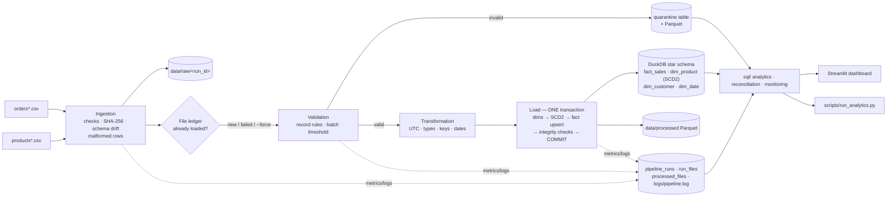

# DataFlow — End-to-End E-Commerce Data Engineering Pipeline

A reproducible, local data platform that ingests two independent sources (order lines and a product
master), validates and quarantines bad records, transforms the rest into a DuckDB star schema with a
Type 2 product dimension, loads it idempotently in a single transaction, and exposes analytics, reconciliation
and run monitoring through SQL files, a CLI report and a Streamlit dashboard.

No cloud services, credentials or API keys are needed.

---

## 1. Business problem

An e-commerce team receives daily CSV exports of order lines from the shop system and of the product catalog
from a PIM. The files contain the usual real-world problems: missing and null values, unparseable numbers and
dates, duplicate or conflicting order lines, references to unknown products, late-arriving orders, catalog
price changes and occasionally a broken export. The team needs trustworthy revenue reporting where

* every source row is accounted for (loaded, or rejected with a reason they can look up),
* historical revenue uses the price actually charged, not today's catalog price,
* re-running a day's files never double counts, and a crashed load never leaves half a batch behind,
* operators can see what ran, when, how long it took and what failed.

## 2. Architecture



More detail (run lifecycle, ER diagram, concurrency model): [`docs/architecture.md`](docs/architecture.md).
Every design choice and its trade-off: [`docs/design_decisions.md`](docs/design_decisions.md).

## 3. Technology stack

| Concern | Choice |
|---|---|
| Language | Python 3.11+ (verified on 3.13) |
| Warehouse | DuckDB (single file `data/warehouse.duckdb`) |
| Transformations / analytics | SQL files in `sql/` + pandas for row-level validation |
| Processed storage | Parquet (pyarrow) |
| Synthetic data | Faker + NumPy, fixed seed |
| Dashboard | Streamlit + Altair, dark theme |
| Tests | pytest |
| Logging | Python `logging`, JSON lines |

## 4. Project structure

```
dataflow/
├── data/
│   ├── sample/                 # committed demo inputs (2 batches)
│   ├── labels/sample/          # injected-defect labels — never read by the pipeline
│   ├── raw/<run_id>/           # untouched copy of every input file per run
│   ├── processed/<run_id>/     # valid rows (Parquet) + processed/warehouse/*.parquet snapshot
│   ├── quarantine/<run_id>/    # rejected rows (Parquet)
│   └── warehouse.duckdb        # the warehouse (created by the pipeline)
├── src/
│   ├── config.py  schemas.py  datagen.py  pipeline.py
│   ├── ingestion/reader.py
│   ├── validation/rules.py
│   ├── transformation/transform.py
│   ├── warehouse/database.py  loader.py
│   ├── analytics/queries.py
│   └── monitoring/logging_setup.py  run_history.py  lock.py  trigger.py
├── sql/
│   ├── ddl/warehouse.sql
│   ├── analytics/01..10_*.sql
│   ├── reconciliation/01..03_*.sql
│   └── monitoring/*.sql        # queries used by the dashboard
├── scripts/  generate_data.py  run_analytics.py  benchmark.py
├── dashboard/app.py    .streamlit/config.toml
├── tests/              # 102 tests (+ dashboard_page.py helper for the dashboard smoke test)
├── docs/   architecture.md  data_dictionary.md  design_decisions.md
├── outputs/            # analytics_report.md, analytics/*.csv, benchmark_*.{md,json}, test_results.txt
├── logs/pipeline.log   # JSON lines
├── requirements.txt  pyproject.toml  .gitignore
```

## 5. Source schemas

**Orders** (PK `order_line_id`): `order_line_id`, `order_id`, `customer_id`, `product_id`, `order_timestamp`
(ISO-8601), `quantity` (integer 1–1000), `unit_price` (decimal > 0, ≤ 2 dp), `order_status`
(`pending|paid|shipped|delivered|cancelled|returned`), `source_file` (optional).

**Products** (PK `product_id`; a version per `updated_at`): `product_id`, `product_name`, `category`,
`brand` (nullable), `list_price`, `product_status` (`active|discontinued|out_of_stock`), `updated_at`,
`source_file` (optional).

Full rules, null tokens, reason codes and batch-level failure codes: [`docs/data_dictionary.md`](docs/data_dictionary.md).

## 6. Warehouse schema

* **fact_sales** — grain: **one row per order line**. `sales_key`, `order_line_id` (unique), `order_id`,
  `product_key`, `customer_key`, `customer_id`, `date_key`, `order_timestamp`, `quantity`, `unit_price`
  (transaction price), `total_amount` (= quantity × unit_price, DECIMAL), `order_status`, `run_id`, plus
  lineage (`row_hash`, `source_file`, `source_seq`, `first_run_id`, `loaded_at`).
* **dim_product** — **Type 2**: one row per version with `valid_from`, `valid_to`, `is_current`, `list_price`.
  Facts point at the version valid at order time (as-of join).
* **dim_customer** — Type 1: `customer_key`, `customer_id`, `first_order_date`.
* **dim_date** — `date_key` (YYYYMMDD), `full_date`, `day`, `month`, `month_name`, `quarter`, `year`,
  `weekday`, `is_weekend`.
* Surrogate keys are deterministic (MD5 of the business key), identical across rebuilds.
* Operational: `pipeline_runs`, `run_files`, `processed_files` (idempotency ledger), `quarantine`.

## 7. Data dictionary

See [`docs/data_dictionary.md`](docs/data_dictionary.md) — every column of sources, warehouse and
operational tables, plus every rejection reason code.

## 8. Setup

Requires **Python 3.11 or newer**. On macOS, `/usr/bin/python3` (Xcode Command Line Tools) is 3.9 and is
**not** supported — use Homebrew's Python (or one from python.org).

**macOS (zsh/bash), verified 2026-11-13 with Homebrew Python 3.12.16 and 3.14.3:**

```bash
brew install python@3.12                 # skip if `python3.12 --version` already works
cd dataflow                              # the project folder
python3.12 -m venv .venv                 # any 3.11+ interpreter works, e.g. python3.13 / python3.14
source .venv/bin/activate                # prompt now starts with (.venv); `deactivate` to leave
python --version                         # must print 3.11 or newer
python -m pip install --upgrade pip
python -m pip install -r requirements.txt
python -m pytest -q                      # expected: 102 passed
```

Windows: `py -3.12 -m venv .venv` then `.venv\Scripts\activate`; the remaining commands are the same.
Every later command in this README assumes the virtual environment is active and the working directory
is the project folder.

## 9. Generate data

`scripts/generate_data.py` always writes **both sources** — `orders.csv` and `products.csv` — plus a labels
file listing the defects it injected. Supported arguments:

| Argument | Default | Meaning |
|---|---|---|
| `--sample` | off | Write the demo dataset to `data/sample` (labels to `data/labels/sample`) and always include the second batch |
| `--orders N` / `--rows N` | 600 | Number of **order lines** (`--rows` is an alias for `--orders`) |
| `--products N` | 60 | Number of products in the catalog |
| `--seed N` | 42 | Random seed; same arguments + seed → byte-identical files |
| `--defect-rate F` | 0.03 | Share of order lines that get an injected defect |
| `--out DIR` | `data/generated/<N>` | Output directory for the input CSVs |
| `--labels DIR` | `data/labels/<out dir name>` | Output directory for `expected_defects.csv` |
| `--with-increment` | off | Also write `products_update.csv` + `orders_batch_2.csv` (second batch) |

```bash
# Demo dataset (already committed in data/sample; regenerating gives byte-identical files)
python scripts/generate_data.py --sample

# 1,000 order lines, 60 products -> data/generated/1000/
python scripts/generate_data.py --rows 1000          # same as: --orders 1000

# 100,000 order lines, 2,000 products -> data/generated/100000/  (~1.5 s)
python scripts/generate_data.py --orders 100000 --products 2000 --seed 42
python scripts/generate_data.py --orders 100000 --products 2000 --with-increment   # + second batch

# Custom location
python scripts/generate_data.py --orders 5000 --products 200 --out data/generated/5k --labels data/labels/5k
```

The files contain slightly **more** rows than requested, on purpose: injected exact/conflicting duplicates,
malformed rows and defective products are added on top. For example `--rows 1000` produces 1,004 order rows
(1,000 distinct `order_line_id`s, ~320 orders) and 65 product rows; `--orders 100000 --products 2000`
produces 100,400 order rows and 2,080 product rows. Both load with
`python -m src.pipeline --orders data/generated/<N>/orders.csv --products data/generated/<N>/products.csv`.

Every dataset contains normal rows, boundary values (quantity 1000, price 0.01), status values needing
normalisation, nulls, malformed rows, exact and conflicting duplicates, invalid product references, bad types,
bad/future timestamps, an order with two customers, and (with the increment) catalog price/status changes, a new
product, late-arriving orders and status corrections. The list of injected defects goes to
`data/labels/<name>/expected_defects.csv`, separate from the inputs.

## 10. Run the pipeline

```bash
python -m src.pipeline                          # batch 1: data/sample/orders.csv + products.csv
python -m src.pipeline \
    --orders data/sample/orders_batch_2.csv \
    --products data/sample/products_update.csv  # batch 2: catalog update, late events, corrections
python -m src.pipeline                          # identical files again -> SKIPPED (no changes)
python -m src.pipeline --force                  # reprocess anyway -> 0 inserts, 0 updates
```

Options: `--db PATH`, `--max-reject-ratio 0.5`. Exit codes: `0` success/skipped, `1` failed, `2` another run
holds the lock. All paths can also be set with `DATAFLOW_DB_PATH`, `DATAFLOW_ORDERS_PATH`,
`DATAFLOW_PRODUCTS_PATH`, `DATAFLOW_RAW_DIR`, `DATAFLOW_PROCESSED_DIR`, `DATAFLOW_QUARANTINE_DIR`,
`DATAFLOW_LOGS_DIR`.

Each run prints a JSON summary, appends JSON log lines to `logs/pipeline.log`, and records itself in
`pipeline_runs`.

## 11. Launch the dashboard

```bash
streamlit run dashboard/app.py          # http://localhost:8501
```

Pages: **Pipeline Overview** (run counts, records ingested/valid/rejected, last run, trend charts),
**Data Quality** (failures by category and reason, searchable rejected-record table with file, line,
record id and reason), **Business Analytics** (revenue, orders, units, AOV, daily/monthly revenue, categories,
top products/customers, purchase frequency) and **Pipeline Runs** (history, per-run drill-down with stage
timings, files, warnings, errors and rejects, file ledger, and a **Run pipeline** button for the sample
batches). All numbers are live SQL against `data/warehouse.duckdb` (or `DATAFLOW_DB_PATH`); screenshots of
the demo warehouse are in [`docs/screenshots/`](docs/screenshots/).

**Browser-verified 2026-11-13** (Google Chrome driven by Playwright, 1440×900 and 390×844, separate temporary
warehouse): all four pages render with charts and tables, no Streamlit exceptions, no horizontal page overflow;
sidebar navigation works; the empty-warehouse state shows a notice. The **Run pipeline** button ran sample
batch 1 → `SUCCESS`, batch 2 → `SUCCESS`, batch 1 again → `SKIPPED`. Simultaneous execution was attempted three
ways while a 405,760-row CLI run held the lock: clicking the button on a page loaded before the run started
(the rerun showed "A pipeline run is in progress", disabled the button and started nothing), opening a second
tab (button disabled) and starting a second CLI run (exit code `2`, `LOCKED`). Exactly one run was recorded;
the button re-enabled once the run finished. The only browser console errors were 404s from Streamlit's own
health probe when a page is opened by deep link (`/quality/_stcore/health`), which the frontend retries at
the root.

## 12. Run the tests

```bash
python -m pytest            # 102 tests, ~15 s; each test uses its own temp warehouse and inputs
python -m pytest -v tests/test_warehouse.py -k idempot
```

Coverage of the required scenarios:

| # | Requirement | Tests (file) |
|---|---|---|
| 1 | Normal ingestion | `test_normal_ingestion_loads_everything` (ingestion) |
| 2 | Empty input | `test_header_only_orders_file`, `test_zero_byte_file_is_empty_not_schema_error`, `test_missing_file_is_batch_failure` |
| 3 | Missing required fields | `test_missing_required_field[7 columns]`, `test_missing_primary_key_is_traceable_by_line_number` |
| 4 | Malformed records | `test_malformed_rows_are_quarantined_not_fatal` |
| 5 | Duplicate order-line IDs | `test_exact_duplicate_keeps_first_quarantines_rest`, `test_conflicting_duplicate_rejects_all_copies` |
| 6 | Null values | `test_null_tokens_treated_as_missing[6 tokens]`, `test_optional_brand_may_be_null` |
| 7 | Invalid product references | `test_invalid_product_reference`, `test_reference_to_product_rejected_in_same_batch_is_invalid`, `test_reference_resolved_from_earlier_batch` |
| 8 | Unexpected schema changes | `test_missing_required_column_fails_batch_and_can_be_retried`, `test_extra_column_is_schema_drift_warning`, `test_headers_normalised_to_snake_case` |
| 9 | Negative quantities | `test_negative_quantity` |
| 10 | Zero quantity | `test_zero_quantity` |
| 11 | Late-arriving events | `test_late_arriving_event_lands_in_correct_period`, `test_late_order_rewinds_customer_first_order_date` |
| 12 | Product catalog updates | `test_catalog_update_creates_new_version_and_keeps_history`, `test_out_of_order_catalog_update_rekeys_facts`, `test_conflicting_redelivery_of_same_product_version_rejected` |
| 13 | Partial failure and retry | `test_partial_failure_rolls_back_and_retry_succeeds`, `test_interrupted_run_is_marked_failed_on_next_start` |
| 14 | Idempotent reruns | `test_rerun_of_identical_files_is_skipped`, `test_forced_rerun_creates_no_duplicates_and_no_changes`, `test_same_content_under_new_filename_is_recognised` |
| 15 | Referential integrity | `test_fact_to_dimension_referential_integrity`, `test_integrity_violation_blocks_commit` |
| 16 | Revenue correctness | `test_revenue_calculation`, `test_decimal_precision_no_float_drift` |
| + | Domain edge cases | cancelled/returned excluded from revenue; order with two customers; order/customer clash with warehouse; timezone offsets → UTC date; status correction updates in place; replaying an old file cannot undo a correction; reject-threshold batch failure; lock prevents simultaneous runs (also across threads); deterministic keys across warehouses; boundary values; price precision; generator determinism; end-to-end sample run matched against injected labels |
| + | Reconciliation | `test_generated_dataset_full_reconciliation_equation` (requested → physical → valid + rejected → facts; every reject explained and its exact source line stored), `test_run_summary_does_not_count_skipped_runs_as_ingested` |
| + | Raw-record traceability | `test_rejected_records_keep_exact_original_text[LF, CRLF]` (quoting, `NULL` tokens, embedded commas/newlines, malformed rows; file rebuilt byte-for-byte), `test_quarantine_parquet_carries_source_line`, `test_blank_lines_are_counted_and_reported`, `test_existing_warehouse_without_source_line_is_upgraded` (tests/test_traceability.py) |
| + | No silent row loss | `test_check_accounting_rejects_lost_rows_and_duplicate_keys`, `test_duplicate_leaking_past_rules_fails_batch_instead_of_vanishing`, `test_every_input_row_is_accounted_for_with_duplicates` |
| + | Dashboard | `test_dashboard_page_renders_from_warehouse[4 pages]`, `test_dashboard_without_warehouse_shows_empty_state` (Streamlit AppTest against a real temp warehouse) |

Latest full run (2026-11-13, macOS arm64, Python 3.14.3): **102 passed in 13.73 s** — log in
[`outputs/test_results.txt`](outputs/test_results.txt).

## 13. Analytical queries

```bash
python scripts/run_analytics.py --list                 # list queries
python scripts/run_analytics.py --query 07_top_10_products
python scripts/run_analytics.py                        # all -> outputs/analytics/*.csv + outputs/analytics_report.md
```

Or directly: `duckdb data/warehouse.duckdb < sql/analytics/01_total_revenue.sql` (DuckDB CLI), or
`duckdb.connect("data/warehouse.duckdb").sql(open(...).read())` in Python.

| File | Question |
|---|---|
| `01_total_revenue` | Recognised revenue (+ pending and cancelled/returned value shown separately) |
| `02_total_orders` | Distinct revenue orders, all orders, order lines |
| `03_total_quantity` | Units sold |
| `04_daily_revenue` / `05_monthly_revenue` | Revenue trend |
| `06_revenue_by_category` | Revenue and share by category (category at time of sale) |
| `07_top_10_products` / `08_top_10_customers` | Rankings |
| `09_average_order_value` | Revenue / distinct revenue orders |
| `10_rejected_record_pct` | Rejected % per source over the latest processing of each file |
| `reconciliation/01_run_reconciliation` | Per run: input = valid + rejected; rejected = quarantine rows; valid orders = facts inserted + updated + unchanged + stale-skipped |
| `reconciliation/02_file_reconciliation` | The same per source file |
| `reconciliation/03_warehouse_reconciliation` | Fact rows = distinct order lines = Σ first inserts; Σ total_amount = Σ qty × price; zero orphans |
| `reconciliation/04_reject_breakdown` | Per file: input = valid + rejected; rejected = Σ categories (malformed, duplicates, missing, types, business rule, references); valid orders = fact rows written |

**Revenue definition:** order lines with status `paid`, `shipped` or `delivered`, valued at the transaction
`unit_price`. Results on the sample warehouse (both batches loaded, see `outputs/analytics_report.md`):
revenue **307,320.17**, **201** revenue orders (246 in any status, 732 order lines), **2,475** units,
average order value **1,528.96**; rejected-record rate **3.25 %** (27 of 831 source rows). All
reconciliation checks pass (re-verified 2026-11-13 after rebuilding `data/warehouse.duckdb` from the sample
with the commands in section 10).

### Reconciliation of a generated dataset

`reconciliation_passes()` in `src/analytics/queries.py` turns all four reconciliation queries into booleans.
Verified for `--orders 100000 --products 2000 --seed 42` in a fresh warehouse:

```
requested order lines             100,000
+ injected exact-duplicate copies     200
+ injected conflicting copies         200
= physical order rows             100,400  = 96,630 loaded facts + 3,770 quarantined
physical product rows               2,080  =  2,000 valid versions +    80 quarantined
all input rows                    102,480  = 98,630 valid          + 3,850 quarantined
```

The 3,850 rejected rows are **3,770 order rows + 80 product rows**. By primary reason:

| Category | Orders | Products |
|---|---:|---:|
| Malformed (wrong field count) | 200 | 0 |
| Duplicates (extra exact copies 200 + all copies of 200 conflicting keys 400; products: superseded 16) | 600 | 16 |
| Missing values (incl. `NULL` tokens and 20 blank `order_line_id`s) | 400 | 16 |
| Invalid types (quantity/price text, bad timestamps) | 502 | 16 |
| Business rules (qty ≤ 0 or > 1000, price, status, future timestamp) | 1,098 | 32 |
| Invalid references (unknown product 200; order with two customers 770) | 970 | 0 |
| **Total** | **3,770** | **80** |

Every quarantined row is either a labelled defect, a blank-key row, or a sibling line of an order with two
customers (next section) — asserted by `test_generated_dataset_full_reconciliation_equation`.

### Whole-order rejection rule (order with more than one customer)

An `order_id` must belong to exactly one `customer_id`. When the lines of a batch (together with orders
already in the warehouse) associate one `order_id` with two or more customers, **every line of that order in
the batch** is quarantined as `INCONSISTENT_ORDER_CUSTOMER`. Lines already loaded are not changed.

* **Why:** nothing in the data says which customer is right, and order-level numbers (order count, average
  order value, customer rankings, first-order dates) would be wrong if only part of the order were loaded.
  Holding back the whole order keeps published figures correct and every held-back line visible.
* **Impact:** one bad line also quarantines its clean siblings. In the 100k dataset, 200 injected lines caused
  **770** rejected rows — **567 otherwise-clean lines**, 0.57 % of all order lines and 20 % of rejected order
  rows. They can be found with `primary_reason = 'INCONSISTENT_ORDER_CUSTOMER'`; each keeps its exact source
  line for re-delivery. The quarantine row does not say which line was the outlier.
* **Decision:** kept unchanged; it is a business rule, and alternatives (majority vote, load-and-flag) are
  discussed in [`docs/design_decisions.md` D14](docs/design_decisions.md).

### Rejected-record traceability

Every quarantined row keeps `source_file`, `source_row_number` (first physical line, header = 1), `run_id`,
`primary_reason`, `rejection_reasons`, `raw_record` (parsed fields as JSON) and **`source_line`: the exact
original CSV text** — quotes, spacing and tokens such as `NULL` unchanged, malformed rows included. The same
columns are in `data/quarantine/<run_id>/*_rejected.parquet`, and the untouched file is in
`data/raw/<run_id>/`. Blank lines are not records; they are counted in a `BLANK_LINES` run warning.
Validation never drops a row itself: valid + rejected must equal the input and valid keys must be unique, or
the batch fails (`ValidationInvariantError`) instead of losing data silently (D15).

## 14. Idempotency and recovery

* **Content ledger.** Each file is fingerprinted (SHA-256). A file already loaded successfully is skipped —
  even under another name. Failed files stay retryable.
* **Upserts on business keys.** Facts are matched on `order_line_id`: identical → untouched, changed →
  updated in place, new → inserted. Dimensions are insert-if-absent; product history is keyed by
  (`product_id`, `updated_at`). A forced rerun produces 0 inserts and 0 updates.
* **No regression on replay.** A changed fact row is only applied if its file arrived at least as late as the
  file that wrote the current version, so backfilling an old file never undoes a later correction.
* **Atomic batches.** Dimensions, facts, quarantine rows and the ledger entry commit in one transaction,
  after referential-integrity checks. Any error rolls back the whole batch.
* **Interrupted processes.** A run left `RUNNING` (process killed) is marked `FAILED` at the next start;
  stale lock files of dead processes are cleared automatically.

**Verified (2026-11-12 and again 2026-11-13 with identical counts; fresh warehouse, `--rows 1000` dataset):**

| Table | After run 1 | After run 2 (same files → `SKIPPED`) | After run 3 (`--force`) |
|---|---:|---:|---:|
| fact_sales | 967 | 967 | 967 |
| dim_product | 60 | 60 | 60 |
| dim_customer | 114 | 114 | 114 |
| dim_date | 181 | 181 | 181 |
| pipeline_runs | 1 | 2 | 3 |
| run_files | 2 | 4 | 6 |
| processed_files | 2 | 2 | 2 (attempts = 2) |
| quarantine | 42 | 42 | 84 |

Run 3 reported 0 inserted, 0 updated, 967 unchanged. `quarantine` is append-only per run by design; the
dashboard and `10_rejected_record_pct` read `v_quarantine_current` (latest processing per file), which still
shows 42.

**Restart after a failure:** fix the cause (e.g. regenerate the export with the missing column) and run the
same command again. Nothing from the failed batch was committed, and the ledger marks the file `FAILED`, so it
is processed normally — no `--force` needed.

**Backfill / reprocess:** `python -m src.pipeline --orders <old file> --products <file> --force`. Rows already
present are verified unchanged; rows previously rejected because their product was missing are loaded if the
product now exists; newer corrections are preserved. To rebuild from scratch, delete
`data/warehouse.duckdb` and replay the files from `data/raw/` in their original order — surrogate keys are
deterministic, so the rebuilt warehouse is identical.

## 15. Performance benchmark

```bash
python scripts/benchmark.py --sizes 1000 100000 --repeats 5
```

For every size and repeat the script generates the data (seed 42, products = max(200, lines / 50)), runs the
pipeline into a **fresh warehouse**, then reruns it with `--force`. Stage timings come from `pipeline_runs`
(the pipeline's own instrumentation); every figure is the **median of 5 repeats**. Full method, environment
and limitations: [`outputs/benchmark_report.md`](outputs/benchmark_report.md) (raw numbers in
`outputs/benchmark_results.json`).

**Measured 2026-11-12 18:47 UTC** on an Apple M1 (8 CPUs), macOS 26.6.2, Python 3.14.3, DuckDB 2.0.0,
pandas 3.1.1; 1-minute load average 4.0–4.5:

| Requested lines | Products | Input rows | Generation s | Ingestion s | Validation s | Transform s | Load s | **Total s** (min–max) | **Rows/s** | Forced rerun s |
|---:|---:|---:|---:|---:|---:|---:|---:|---:|---:|---:|
| 1,000 | 200 | 1,212 | 0.033 | 0.011 | 0.022 | 0.015 | 0.044 | 0.118 (0.112–0.367) | 10,271 | 0.113 |
| 100,000 | 2,000 | 102,480 | 0.833 | 0.458 | 0.629 | 0.459 | 0.367 | 2.056 (2.003–2.740) | 49,844 | 2.303 |

`Total` is the run's `duration_seconds`, which also includes locking, schema setup, raw-file copies, Parquet
exports and bookkeeping. Forced reruns inserted 0 facts and left the fact count unchanged in every repeat.
Loading 20,000 rows set-based (Arrow scan + one `INSERT … SELECT`) took 0.0045 s versus 3.965 s row by row
(`executemany`), **886×** faster (single measurement).

**Where the time goes** (cProfile, 100k): validation is the largest stage (pandas regex/type checks, duplicate
fingerprints), followed by CSV reading and surrogate keys (~199k Python MD5 calls). The DuckDB load is the
smallest stage. At 1k rows, fixed per-run costs dominate, so its rows/s is not comparable with 100k.

**Timing limitations:** one laptop, one seed, 3 % defect rate; wall-clock times vary with other processes
(an earlier session under load average 14–20 measured 2.7–17 s for the same 100k run), so check the min–max
spread and load average in the report before comparing machines.

**Generator fix:** `inject_order_defects` rebuilt a set of defect positions for every row (O(rows × defects),
300 M generator steps at 100k). Hoisting it reduced 100k generation from ~30 s to under 1 s in-process
(~1.4 s via the CLI) with byte-identical output.

## 16. Known limitations

* Single-node, single-writer (DuckDB). While a run holds the lock the dashboard shows a RUNNING status and
  disables the run button; it shows the last loaded data, or a "pipeline is writing" notice if the database
  cannot be read at that moment.
* Orders carry no version/`updated_at`, so correction ordering relies on file arrival order (see D7).
* Returns remove the whole line value from revenue; partial refunds are not modelled.
* The future-timestamp check is relative to the run time (24 h tolerance); the sample is dated Jan–Aug 2026.
* Raw files are copied per run, including forced reruns (no hash-level de-duplication of raw storage).
* Validation and key hashing run in pandas/Python (the largest stages at 100k rows); fine to ~millions of rows
  per batch, beyond that move them into SQL.
* An order whose lines name two customers is rejected as a whole (section 13), so one bad line quarantines its
  clean sibling lines too; the quarantine row does not identify which line was the outlier.
* Quarantine rows written by a warehouse that predates `source_line` keep `source_line = NULL` (the column is
  added automatically); rebuild the warehouse or use `data/raw/<run_id>/` + `source_row_number` for them.
* Referential integrity is enforced by checks inside the load transaction, not by declared `FOREIGN KEY`
  constraints (DuckDB foreign keys block the in-place updates the upserts need).
* `brand` is the only optional business attribute; there is no customer master, so `dim_customer` has no
  descriptive attributes.

## 17. Troubleshooting

| Symptom | Cause / fix |
|---|---|
| `generate_data.py: error: unrecognized arguments` | Supported flags are listed in section 9; use `--orders` or its alias `--rows`. |
| Pipeline exits with code `2` | Another run holds the lock (`logs/pipeline.lock`). Wait for it; if that process is dead, just rerun — stale locks are cleared automatically. |
| Run status `SKIPPED` | Identical file content was already loaded. Use `--force` to re-evaluate (no duplicates are created). |
| Run `FAILED` with a schema error | A required column is missing. Fix the export and rerun the same command; no `--force` needed. |
| Dashboard says "The pipeline is writing…" | DuckDB is single-writer; refresh once the run finishes. |
| Dashboard shows another warehouse | It reads `DATAFLOW_DB_PATH` (default `data/warehouse.duckdb`), shown in the sidebar. |
| `pip install` fails, or `SyntaxError`/`TypeError` on import | The venv was built with Python < 3.11 (macOS `/usr/bin/python3` is 3.9). Delete `.venv` and recreate it with `python3.12 -m venv .venv` (section 8). |
| `command not found: streamlit` / `pytest` | The virtual environment is not active: `source .venv/bin/activate`. |
| `TypeError` about `width="stretch"` in the dashboard | Streamlit is older than 1.50; `pip install -r requirements.txt` upgrades it. |
| Verifying without touching real data | Set `DATAFLOW_DB_PATH`, `DATAFLOW_RAW_DIR`, `DATAFLOW_PROCESSED_DIR`, `DATAFLOW_QUARANTINE_DIR`, `DATAFLOW_LOGS_DIR` to a temp directory, or use `--db`. |

## 18. Future improvements

* Compute surrogate keys and row hashes inside DuckDB (`md5`) to roughly halve transformation time.
* Partitioned Parquet lake (by order date) with DuckDB external tables for very large histories.
* Orchestrate with Airflow/Dagster (each stage is already a function with persisted state) and alert on
  failed runs or rejection-rate spikes.
* Data contracts in YAML with versioning; quarantine re-processing UI ("release" fixed records).
* A customer source to make `dim_customer` a proper Type 2 dimension.

## 19. Security

No secrets are used or stored. `.gitignore` excludes `.env` and Streamlit secrets in case they are added later.
# YottaFlex-72hrs-challenge
