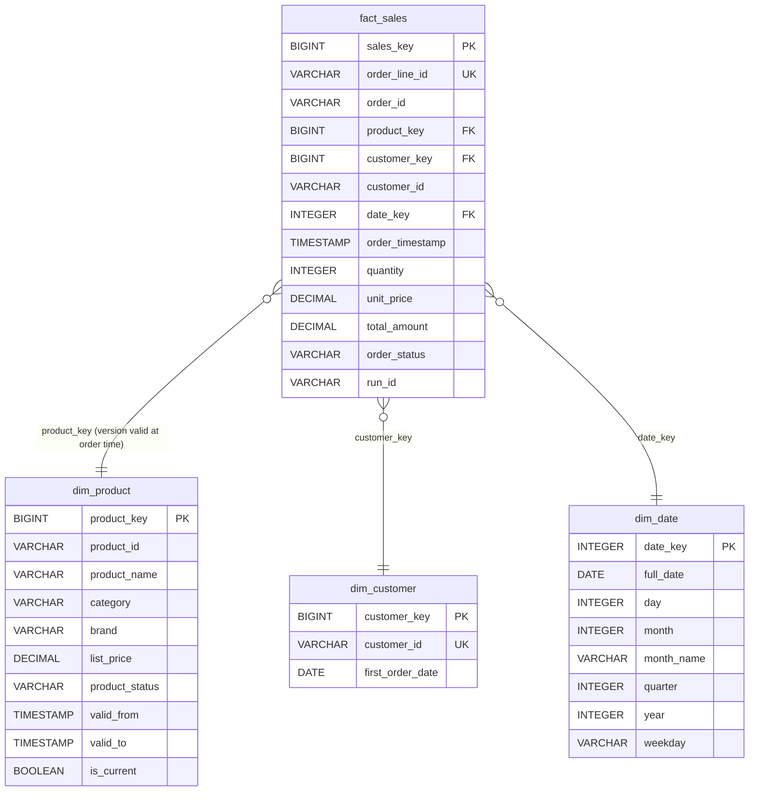

# Architecture

## Data flow

```mermaid
flowchart LR
    subgraph Sources
        O[orders*.csv]
        P[products*.csv]
    end

    subgraph Pipeline["src/pipeline.py  (one run = one run_id, guarded by logs/pipeline.lock)"]
        I["Ingestion<br/>src/ingestion/reader.py<br/>file checks · SHA-256 · header snake_case<br/>schema-drift detection · malformed rows"]
        R[("Raw landing<br/>data/raw/&lt;run_id&gt;/")]
        L{"Ledger check<br/>processed_files"}
        V["Validation<br/>src/validation/rules.py<br/>record-level rules · batch threshold"]
        Q[("Quarantine<br/>quarantine table +<br/>data/quarantine/&lt;run_id&gt;/*.parquet")]
        T["Transformation<br/>src/transformation/transform.py<br/>types · UTC · surrogate keys<br/>date attributes · row hashes"]
        W["Warehouse load (ONE transaction)<br/>src/warehouse/loader.py<br/>dims → SCD2 windows → facts upsert<br/>→ integrity checks → COMMIT"]
    end

    subgraph DuckDB["data/warehouse.duckdb"]
        F[fact_sales]
        DP[dim_product · SCD2]
        DC[dim_customer]
        DD[dim_date]
        M[(pipeline_runs · run_files<br/>processed_files)]
    end

    PQ[("data/processed/<br/>valid Parquet + warehouse snapshot")]
    SQL["sql/analytics · sql/reconciliation<br/>sql/monitoring"]
    UI["Streamlit dashboard<br/>dashboard/app.py (read-only)"]
    CLI["scripts/run_analytics.py<br/>outputs/analytics_report.md"]

    O --> I
    P --> I
    I --> R
    I --> L
    L -- new / failed / --force --> V
    L -- already SUCCESS --> M
    V -- invalid --> Q
    V -- valid --> T --> W
    W --> F & DP & DC & DD
    W --> PQ
    I -. metrics .-> M
    V -. metrics .-> M
    W -. metrics .-> M
    F & DP & DC & DD & M & Q --> SQL
    SQL --> UI
    SQL --> CLI
    UI -- "Run pipeline (subprocess)" --> Pipeline
```

## Star schema



## Run lifecycle

1. **Lock** – `logs/pipeline.lock` is created with `O_EXCL` (pid + run_id). A second run (CLI, dashboard
   click, thread) gets `PipelineLockedError` / exit code 2. Stale locks of dead processes are cleared.
2. **Bootstrap** – DDL is applied idempotently; runs left `RUNNING` by a killed process are marked `FAILED`.
   A `RUNNING` row is written for this run.
3. **Ingestion** – both files are read as text with the `csv` module; wrong field counts become
   `MALFORMED_RECORD`s; missing mandatory columns raise a batch error. The file is copied unchanged to
   `data/raw/<run_id>/` and fingerprinted with SHA-256.
4. **Ledger** – a file whose hash is already `SUCCESS` in `processed_files` is skipped unless `--force`.
   If both files are skipped the run ends `SKIPPED`.
5. **Validation** – products first (so orders can reference products from the same delivery), then
   orders against `valid products ∪ dim_product`. Batch threshold check.
6. **Transformation** – deterministic keys, UTC timestamps, date attributes, row hashes.
7. **Load** – `BEGIN` → `dim_date` → `dim_customer` → `dim_product` (+ recompute SCD2 windows, re-point
   affected facts) → `fact_sales` upsert → integrity checks → quarantine rows → ledger → `COMMIT`.
   Any exception → `ROLLBACK`; nothing from the batch is visible.
8. **Exports** – valid rows and rejects to Parquet; warehouse tables snapshotted to
   `data/processed/warehouse/*.parquet`.
9. **Finish** – the run row gets status, counts, stage timings, warnings, error.

## Concurrency model

DuckDB allows one writer process. The pipeline holds the only read-write connection for the duration of a
run. The dashboard opens short-lived **read-only** connections per page render and closes them; if the
pipeline is writing, the page shows "pipeline is writing, refresh shortly" instead of failing, and the
pipeline retries its connection for up to `DATAFLOW_DB_CONNECT_TIMEOUT` seconds (default 30) if a dashboard
read is in flight. The dashboard's run button launches the pipeline as a subprocess, so the dashboard
process itself never writes.

## Module map

| Path | Responsibility |
|---|---|
| `src/config.py` | Paths and thresholds; env-var overrides; `Settings.for_root()` for isolated runs. |
| `src/schemas.py` | Source contracts, allowed statuses, numeric bounds. |
| `src/datagen.py`, `scripts/generate_data.py` | Seeded synthetic data + separate defect labels. |
| `src/ingestion/reader.py` | File/structure checks, normalisation, schema drift, raw preservation. |
| `src/validation/rules.py` | Record-level rules, reason codes, quarantine frame. |
| `src/transformation/transform.py` | Surrogate keys, staging frames for dims and facts. |
| `src/warehouse/database.py`, `loader.py` | Connections, DDL, transactional idempotent load, integrity checks. |
| `src/monitoring/` | JSON logging, run history, lock, out-of-process trigger. |
| `src/analytics/queries.py` | Loads and runs SQL from `sql/`. |
| `src/pipeline.py` | Orchestration + CLI. |
| `dashboard/app.py` | Presentation only. |
